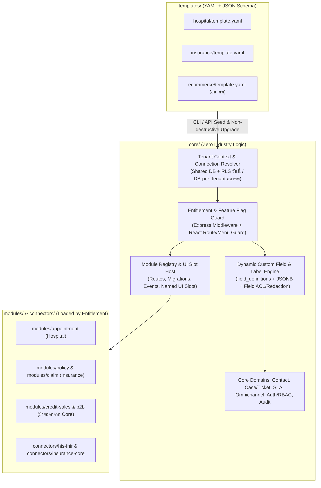

# Phase 0: Current-State Architecture Audit (`cusbox360`)

> **เอกสารสำรวจสถานะปัจจุบัน (เฟส 0 — Read-Only Audit)**
> เป้าหมาย: วิเคราะห์โครงสร้าง codebase, Tech Stack, Database Schema, Build/Deploy Pipeline, จุดที่ผูกติดกับธุรกิจเฉพาะ (Hard-coded Coupling), ความเสี่ยงเชิงสถาปัตยกรรม/ความปลอดภัย และประเด็นคำถามที่ต้องตัดสินใจร่วมกันก่อนเริ่มออกแบบใน **เฟส 1 (`01-target-design.md`)**

---

## 1. Executive Summary (บทสรุปภาพรวม)

ปัจจุบัน **CusBox360 (`cb360`)** เป็นระบบ **Single-Tenant Monolith (SPA + Express API)** ที่เริ่มต้นจากการเป็นระบบ **CDP + B2B Wholesale & Credit Sales** (ขายเครื่องพิมพ์/หมึกพิมพ์แบบมีวงเงินเครดิต) และต่อมาได้มีการต่อยอดฟีเจอร์ **Scoped Business Templates & Industry Profiles** เข้ามาใน commit ล่าสุด (`98bd2b8`)

แม้ codebase จะมีรากฐานที่ดีหลายส่วน (เช่น TypeScript `strict: true`, Zod validation ร่วมกันใน `shared/`, การเข้ารหัส AES-256-GCM สำหรับ TOTP, และชุดทดสอบ Vitest **48 ไฟล์ / 302 tests ผ่าน 100%**) แต่เมื่อเทียบกับสถาปัตยกรรมเป้าหมาย **"Single Core + Industry Templates + Runtime Configuration"** พบช่องว่างหลัก 5 ประการ:

1. **Single-Tenant 100%**: ทั้ง 13 ตารางใน PostgreSQL ไม่มี `tenant_id` และฝั่ง Backend เก็บสถานะสำคัญไว้ในตัวแปร Global Singleton ใน RAM (`botSettings`, `cachedToken`, `inMemory*` Maps)
2. **Templates & Industry Logic ยังเป็น Code ไม่ใช่ Runtime Config**: เทมเพลตธุรกิจถูกเขียนเป็นไฟล์ TypeScript (`src/data/businessTemplates.ts`), ประเภทธุรกิจถูกล็อกด้วย Union Types / Zod Enums / SQL `CHECK` Constraint และหน้า UI ใช้ `switch (kind)` เรนเดอร์คอมโพเนนต์เฉพาะธุรกิจ (`HospitalProfilePanel`, `VehicleList`, `LogisticsProfilePanel`)
3. **ยังไม่มี Template & Module สำหรับธุรกิจ `insurance` แยกอิสระ**: ข้อมูลกรมธรรม์ (`insurancePolicies`) ถูกฝังเป็น sub-array อยู่ใน `hospitalProfileSchema` เท่านั้น ยังไม่มี `policy` / `claim` module สำหรับบริษัทประกันหรือโบรกเกอร์ประกันภัยโดยตรง
4. **Split-Brain Persistence (`localStorage` vs PostgreSQL)**: ฟีเจอร์หลักอย่าง **Ticket/Case, SLA, Menu Visibility, Active Business Template, Deal Pipeline, Credit Sales** ยังเก็บอยู่ใน `localStorage` หรือ Mock Array ฝั่ง Browser ไม่มีตารางและ API ฝั่ง Backend รองรับ
5. **ความเสี่ยงด้านความปลอดภัย (P0)**: พบการฝัง LINE Channel Secret / Access Token จริงลงในไฟล์ Frontend (`src/data/connectors.ts`, `src/pages/ConnectorsPage.tsx`) ซึ่งจะติดไปกับ Docker Image เดียวของทุกธุรกิจหากไม่แยกออก

---

## 2. สรุป Tech Stack และโครงสร้างปัจจุบัน

### 2.1 Technology Stack

| Layer | เทคโนโลยีปัจจุบัน | รายละเอียดใน Codebase |
|---|---|---|
| **Frontend** | React 18.3 + TypeScript 5.7 + Vite 6 | SPA (`strict: true`), React Router v6 (`src/App.tsx`), State ผ่าน React Context 11 ตัว |
| **Styling & UI** | Tailwind CSS 3.4 + Lucide Icons + `@dnd-kit` | ฟอนต์ `IBM Plex Sans Thai` / `IBM Plex Mono`, ธีมสี Light Blue (`#1F6FD1`) ตายตัวใน `tailwind.config.js` |
| **Backend API** | Node.js 20 (ESM) + Express 5.2 | Plain JavaScript (`server/`), เสิร์ฟทั้ง `/api/*`, `/v1/webhooks/*` และ static files จาก `dist/` |
| **Shared Layer** | Plain ESM JS + Zod 4.6 (`shared/`) | แชร์ Schema และ Access Policy ระหว่าง Vite Frontend กับ Node Backend |
| **Database** | PostgreSQL (`pg` v8.13 Pool) | เชื่อมผ่าน `DATABASE_URL` (`db.js`, `max: 10`) ไม่มี ORM / Query Builder เขียน Raw SQL โดยตรง |
| **Auth & Security** | Cookie Session (`cb360_sid`) + Scrypt + TOTP 2FA | Hash token ด้วย SHA-256 ลงตาราง `sessions`, เข้ารหัส TOTP Secret ด้วย AES-256-GCM (`cryptoUtils.js`) |
| **External Integrations** | LINE Messaging API, Google Gemini AI, Google Maps, 3CX | LINE Push/Reply จริง (`lineService.js`), Gemini AI สรุปแชท/ร่างคำตอบ (`geminiService.js`), 3CX URL Screen-Pop (`/crm`) |
| **Testing** | Vitest 5.0 (`environment: 'node'`) | **48 test files / 302 unit & controller tests ผ่าน 100%**, `tsc --noEmit` ผ่าน 0 errors |
| **Build & Deploy** | Multi-stage `Dockerfile` + `nixpacks.toml` | Build ครั้งเดียวได้อิมเมจ `node:20-alpine` รัน `node server.js` ที่พอร์ต `3000` (ยังไม่มี CI/CD pipeline และยังไม่มี `deploy/` สำหรับ Helm/Compose) |
| **Git Branches** | `main`, `feature/phase-1a-auth` (merged ancestor) | **ยังไม่มีการแยก branch/fork ตามลูกค้า** (เหมาะอย่างยิ่งต่อการวางรากฐาน Single Core ตอนนี้) |

### 2.2 โครงสร้างไดเรกทอรีปัจจุบัน

```text
cusbox360/
├── server.js                  # Express entrypoint + static SPA server + auto-DDL & user seeding ตอนบูต
├── db.js                      # PostgreSQL Pool (single global DATABASE_URL)
├── migrate.js                 # สคริปต์สร้างตารางชุดแรก + seed ข้อมูลแชท/ข้อความด่วนธุรกิจโรงพิมพ์ B2B
├── Dockerfile / nixpacks.toml # Single-image build config
├── server/
│   ├── config/                # env.js, defaultBotSettings.js (B2B printing defaults)
│   ├── controllers/           # Express route handlers (10 controllers)
│   ├── middlewares/           # requireAuth, bindActor, rateLimit, verifyLineSignature
│   ├── prompts/               # Markdown system prompts สำหรับ Gemini AI
│   ├── repositories/          # PostgreSQL + in-memory Map fallback (5 repositories)
│   ├── routes/                # /api/* และ /api/webhooks/*
│   ├── services/              # auth, botEngine, dbInit, gemini, industryProfile, line, userSeed
│   └── utils/                 # cryptoUtils, totpServer, piiMasker, promptBuilder, aiSchemaValidator
├── shared/                    # โค้ดที่ใช้ร่วมทั้ง FE/BE: industrySchemas, industryProfileSeed, medicalAccessPolicy, agentSkills
├── src/
│   ├── components/            # UI แยกตามฟีเจอร์ (มี customer-360/industry/* ผูกธุรกิจเฉพาะ)
│   ├── context/               # Global state providers 11 ตัว (Auth, BusinessTemplate, Menu, Customer, Bot ฯลฯ)
│   ├── data/                  # Mock data + Preset ธุรกิจ (businessTemplates.ts, industryConnectors.ts ฯลฯ)
│   ├── domain/                # Pure logic (auth, consent, customer, industry/*, layout, telephony, templates/*)
│   ├── hooks/                 # Custom React hooks
│   ├── pages/                 # 18 หน้าจอหลัก (มีไฟล์ขนาดใหญ่เกิน 200 บรรทัดหลายไฟล์)
│   ├── services/              # API clients & localStorage adapters
│   └── types/                 # TypeScript interfaces
└── tests/                     # Domain unit tests เพิ่มเติม (นอกเหนือจาก *.test.* ข้างไฟล์จริง)
```

---

## 3. Database Schema & Persistence Gap ปัจจุบัน

### 3.1 ตารางใน PostgreSQL ทั้งหมด (13 ตาราง — ไม่มี `tenant_id` เลย)

ปัจจุบันการสร้างตารางกระจายอยู่ **3 จุด** (`migrate.js`, `server/services/dbInitService.js`, และ `server/services/botEngineService.js`) โดยไม่มีตารางเก็บประวัติเวอร์ชันของ Migration (`schema_migrations`):

| ตาราง | ไฟล์ที่สร้าง (DDL) | Primary Key | เก็บ JSONB | มี `tenant_id`? | หมายเหตุ |
|---|---|---|---|---|---|
| `conversations` | `migrate.js:11-31`, `dbInitService.js:25-27` | `id TEXT` | - | ไม่ | แชท LINE/FB ทั้งระบบกองรวมกัน |
| `messages` | `migrate.js:35-47`, `dbInitService.js:28-29` | `id TEXT` | - | ไม่ | FK `conversation_id` |
| `canned_responses` | `migrate.js:62-74` | `id TEXT` | - | ไม่ | `shortcut TEXT UNIQUE` ชนกันทันทีถ้ามีหลาย tenant (และไม่มีคอลัมน์ `business_scope` ใน DB!) |
| `ai_summaries` | `migrate.js:78-83`, `dbInitService.js:58-63` | `conversation_id TEXT` | `result` | ไม่ | Cache สรุปแชท AI |
| `ai_usage_logs` | `migrate.js:85-97`, `dbInitService.js:65-77` | `id TEXT` | - | ไม่ | Telemetry การใช้ AI |
| `connector_settings` | `dbInitService.js:37-41` | `id TEXT` | `config` | ไม่ | เก็บแค่แถว `id = 'line'` ตัวเดียวทั้งเซิร์ฟเวอร์ |
| `bot_settings` | `botEngineService.js:12-17` | `id TEXT` | `config` | ไม่ | เก็บแค่แถว `id = 'default'` ตัวเดียวทั้งเซิร์ฟเวอร์ |
| `audit_logs` | `dbInitService.js:43-54` | `id TEXT` | - | ไม่ | บันทึก Audit รวมทุกผู้ใช้ |
| `users` | `dbInitService.js:81-103, 142-146` | `id TEXT` | `skills` | ไม่ | `username TEXT UNIQUE` ทั้งระบบ + ล็อก `CHECK (role IN (...))` |
| `sessions` | `dbInitService.js:106-115` | `id TEXT` | - | ไม่ | FK `user_id` |
| `menu_configs` | `dbInitService.js:119-132` | `id TEXT` | `allowed_roles` | ไม่ | **Dead Table**: สร้างตารางไว้แต่ไม่มี API/Repository ใดเรียกใช้จริง (`MenuContext` ใช้ `localStorage` แทน) |
| `customers` | `dbInitService.js:157-164` | `id TEXT` | `data` | ไม่ | เก็บ payload `Customer` ทั้งก้อนใน `data JSONB` |
| `customer_industry_profiles` | `dbInitService.js:148-155` | `(customer_id, kind)` | `data` | ไม่ | **มีบั๊ก SQL Constraint** (ดูหัวข้อ 5.2) |
| `consent_dsr_requests` | `dbInitService.js:167-174` | `id TEXT` | `data` | ไม่ | คำร้อง PDPA DSR |
| `consent_policies` | `dbInitService.js:176-182` | `id TEXT` | `data` | ไม่ | นโยบายความเป็นส่วนตัว (บังคับ `is_active = TRUE` ได้ทีละ 1 แถวทั้ง DB) |

### 3.2 ช่องว่างการเก็บข้อมูล (Frontend `localStorage` / Mock vs Backend DB)

| โมดูล / ข้อมูล | แหล่งเก็บข้อมูลจริงปัจจุบัน | ผลกระทบต่อสถาปัตยกรรมเป้าหมาย |
|---|---|---|
| **Active Template & Production Lock** | `localStorage` (`cb360_business_template_state`) | เปลี่ยนเครื่อง/เปิดเบราว์เซอร์ใหม่ค่าหาย; CLI `tenant create --template` สั่งตั้งค่าไม่ได้ |
| **Menu Permissions & Visibility** | `localStorage` (`cb360_menus_config`) | ปิดเมนูแค่ฝั่ง UI บนเบราว์เซอร์เดียว ไม่มี API Entitlement Guard ฝั่ง Backend |
| **Tickets / Cases & SLA** | React Memory (`src/data/tickets.ts`) | รีเฟรชหน้าเว็บแล้ว Ticket ที่เพิ่งสร้างหาย; ไม่มี SLA Engine และ Ticket Categories ใน DB |
| **Sales Pipeline (Deals)** | React Memory (`src/data/deals.ts`) | ข้อมูลไม่อยู่ใน DB |
| **Segments & Tiers** | React Memory (`src/data/segments.ts`, `tiers.ts`) | ข้อมูลและกฎ Segment ไม่อยู่ใน DB |
| **Credit Sales** | React Memory (`src/data/credit.ts`) | โมดูลเฉพาะ B2B ฝังอยู่ใน Core `CustomerContext` |
| **Connectors (ยกเว้น LINE Token)** | `localStorage` (`cb360_connectors_config`) | ตั้งค่า HIS / Insurance / Meta / 3CX ไม่ถูกเก็บต่อ Tenant บนเซิร์ฟเวอร์ |

---

## 4. รายการจุดที่ Hard-Code ผูกกับธุรกิจเฉพาะ (ระบุไฟล์ + บรรทัด)

### 4.1 ระดับ Database Schema, Roles & Shared Domain (`migrate.js`, `server/`, `shared/`)

| ไฟล์ (พร้อมเลขบรรทัด) | สิ่งที่ถูก Hard-code | ปัญหาต่อสถาปัตยกรรมเป้าหมาย |
|---|---|---|
| [dbInitService.js](file:///c:/atgv/cb360/server/services/dbInitService.js#L86) และ [L142-L144](file:///c:/atgv/cb360/server/services/dbInitService.js#L142-L144) | `CHECK (role IN ('sysadmin', 'admin', 'SF_1', 'SF_2', 'SF_3', 'supervisor', 'doctor', 'nurse'))` | เอา Role เฉพาะโรงพยาบาล (`doctor`, `nurse`) และทีมขาย B2B (`SF_1..3`) ไปฝังในตาราง `users` ของ Core |
| [dbInitService.js](file:///c:/atgv/cb360/server/services/dbInitService.js#L148-L155) | `customer_industry_profiles` ล็อก `CHECK (kind IN ('hospital', 'auto_service', 'logistics'))` | เพิ่มธุรกิจใหม่ต้องแก้ DDL ทุกครั้ง และปัจจุบันลืมอัปเดต `contact_center` จนเซฟลง DB จริงพัง |
| [migrate.js](file:///c:/atgv/cb360/migrate.js#L116-L185) | Seed แชท (`สั่งหมึกพิมพ์`, `SO-10482`, `บจก. นำชัยการพิมพ์`) และ Canned Responses 15 ข้อ (สลิปโอน KBANK บจก. คัสบอกซ์, เครดิตเทอม ภ.พ.20) | ผูกข้อมูลตั้งต้นของระบบเข้ากับธุรกิจขายเครื่องพิมพ์ B2B |
| [industrySchemas.js](file:///c:/atgv/cb360/shared/industrySchemas.js#L15-L121) | `INDUSTRY_KINDS`, `hospitalProfileSchema`, `autoServiceProfileSchema`, `logisticsProfileSchema`, `contactCenterProfileSchema` | Hard-code ฟิลด์เฉพาะธุรกิจเป็นโค้ด Zod แทนที่จะสร้างจากตาราง `field_definitions` แบบ Dynamic |
| [medicalAccessPolicy.js](file:///c:/atgv/cb360/shared/medicalAccessPolicy.js#L12-L61) | `FULL_ACCESS_ROLES = ['admin', 'doctor']`, `HOSPITAL_FIELDS`, `NURSE_EDITABLE_FIELDS`, `redactHospitalProfile` | กฎการซ่อนข้อมูลอ่อนไหว (PDPA ม.26) ผูกตายตัวกับชื่อฟิลด์ของโรงพยาบาลและ role `doctor`/`nurse` |
| [industryProfileService.js](file:///c:/atgv/cb360/server/services/industryProfileService.js#L40-L75) | `if (kind !== 'hospital')` (L40) และ `if (kind === 'hospital')` (L56) | มี `if (kind === 'hospital')` อยู่ใน Service กลางโดยตรง (ขัดหลักการข้อ 3) |
| [industryProfileSeed.js](file:///c:/atgv/cb360/shared/industryProfileSeed.js#L5-L92) | ข้อมูลจำลองผู้ป่วย `HN-6904812`, รถยนต์ Toyota/Honda, พัสดุ `SHP-C00123` ผูกกับรหัส `C00123` / `C00124` | Seed data เฉพาะธุรกิจถูก import เข้า Repository หลักของเซิร์ฟเวอร์ |
| [userSeedService.js](file:///c:/atgv/cb360/server/services/userSeedService.js#L8-L17) & [userController.js](file:///c:/atgv/cb360/server/controllers/userController.js#L7) | สร้างผู้ใช้ `doctor` (`นพ. กิตติพงศ์`) และ `nurse` (`พว. รพีพร`) ทุกครั้งที่ระบบบูต + ল็อก Zod enum ของ Role | ลูกค้าธุรกิจประกันภัยหรือ E-commerce จะมีบัญชีแพทย์/พยาบาลติดไปในระบบเสมอ |
| [agentSkills.js](file:///c:/atgv/cb360/shared/agentSkills.js#L3-L104) | ล็อก Skill มีแค่ `['telephone', 'line_chat_shop']` และ seed พนักงาน Social Commerce 6 คน | Skill การรับงาน (เช่น เคลมประกัน, นัดหมายแพทย์, เภสัชกร) ปรับตาม Template ไม่ได้ |

### 4.2 ระดับ Backend Bot, AI Prompts & Webhooks (`server/`)

| ไฟล์ (พร้อมเลขบรรทัด) | สิ่งที่ถูก Hard-code | ปัญหาต่อสถาปัตยกรรมเป้าหมาย |
|---|---|---|
| [defaultBotSettings.js](file:///c:/atgv/cb360/server/config/defaultBotSettings.js#L1-L191) | ข้อมูลบริษัท `บจก. คัสบอกซ์ สามหกศูนย์`, ขายเครื่องพิมพ์รุ่น Pro 45,000 บาท, กฎบอทเรื่องใบกำกับภาษี ภ.พ.20 / เครดิตเทอม 30-60 วัน | ค่าเริ่มต้นของ Bot Engine ผูกกับธุรกิจค้าส่งอุปกรณ์สำนักงาน B2B |
| [botEngineService.js](file:///c:/atgv/cb360/server/services/botEngineService.js#L7) & [L108-L113](file:///c:/atgv/cb360/server/services/botEngineService.js#L108-L113) | Singleton `let botSettings` + แทนค่า `.replace(/{order_code}/g, 'SO-10482')` และ `.replace(/{tracking_no}/g, 'TH2609-88412')` ตายตัว | แยกค่าบอทต่อ Tenant ไม่ได้ และยัดเลข Order/พัสดุปลอมใส่ข้อความตอบลูกค้าจริงบน LINE |
| [lineService.js](file:///c:/atgv/cb360/server/services/lineService.js#L6) & [L18-L50](file:///c:/atgv/cb360/server/services/lineService.js#L18-L50) | `let cachedToken = null`, คิวรี `WHERE id = 'line'`, และอ่านไฟล์ `.env` ตรงจากดิสก์ | รองรับ LINE OA ได้เพียงบัญชีเดียวทั้งเซิร์ฟเวอร์ |
| [verifyLineSignature.js](file:///c:/atgv/cb360/server/middlewares/verifyLineSignature.js#L68) & [webhookController.js](file:///c:/atgv/cb360/server/controllers/webhookController.js#L7) & [L68-L70](file:///c:/atgv/cb360/server/controllers/webhookController.js#L68-L70) | ตรวจลายเซ็นด้วย `env.LINE_CHANNEL_SECRET` ตัวเดียว, fallback `channelId = '2011580063'`, และผูกแชทใหม่เข้า `'cb360 Official'` / `'วิภา ส.'` | ไม่สามารถรับ Webhook แยกตาม Tenant/Channel จาก DB ได้ |
| [promptBuilder.js](file:///c:/atgv/cb360/server/utils/promptBuilder.js#L121-L131), [aiCustomerFallback.js](file:///c:/atgv/cb360/server/services/aiCustomerFallback.js#L7-L68), [aiAssistantService.js](file:///c:/atgv/cb360/server/services/aiAssistantService.js#L128-L138) & [L250-L280](file:///c:/atgv/cb360/server/services/aiAssistantService.js#L250-L280) | Fallback context เป็น `SO-10482`, `TH2609-88412`, regex ดักคำว่า `เครื่องพิมพ์|ใบเสนอราคา|เพิ่มวงเงิน`, สรุปแชท fallback เรื่องต่อสัญญาหมึกพิมพ์ 85,000 บาท | AI Copilot มีสมมติฐานธุรกิจขายหมึกพิมพ์ฝังอยู่ในโค้ด Core |
| [knowledge.md](file:///c:/atgv/cb360/server/prompts/knowledge.md#L1-L6), [suggest_reply.md](file:///c:/atgv/cb360/server/prompts/suggest_reply.md#L36-L38), [summary.md](file:///c:/atgv/cb360/server/prompts/summary.md#L15) & [L28-L30](file:///c:/atgv/cb360/server/prompts/summary.md#L28-L30) | Prompt ระบุฟิลด์ `<customer_context>` เป็น `คำสั่งซื้อล่าสุด: {last_orders}` และ ল็อก `intent` เป็น `order_status \| purchase \| credit` | โครงสร้าง Prompt ยังไม่รองรับบริบทผู้ป่วย (HN/นัดหมาย) หรือผู้เอาประกัน (กรมธรรม์/เคลม) แบบ config-driven |

### 4.3 ระดับ Frontend Core, Types, Templates & UI (`src/`, `index.html`, `tailwind.config.js`)

| ไฟล์ (พร้อมเลขบรรทัด) | สิ่งที่ถูก Hard-code | ปัญหาต่อสถาปัตยกรรมเป้าหมาย |
|---|---|---|
| [src/types/index.ts](file:///c:/atgv/cb360/src/types/index.ts#L81-L124), [L244](file:///c:/atgv/cb360/src/types/index.ts#L244), [L335](file:///c:/atgv/cb360/src/types/index.ts#L335), [L544-L552](file:///c:/atgv/cb360/src/types/index.ts#L544-L552) | `Customer` interface ฝัง `creditGrade`, `creditLimit`, `orders12Months`, `lastOrderCode`; `Ticket['category']` ล็อก 7 หมวดตายตัว; `BusinessTemplateId` ล็อก 5 ค่า | โมเดล Core `Customer` และ `Ticket` ยึดติดกับ B2B Commerce ไม่ใช่ Generic Contact + Custom Fields |
| [BusinessTemplateContext.tsx](file:///c:/atgv/cb360/src/context/BusinessTemplateContext.tsx#L16-L80) & [useBusinessTemplate.ts](file:///c:/atgv/cb360/src/hooks/useBusinessTemplate.ts#L26-L30) | ล็อก `templateIdSchema` 5 ธุรกิจ, default เป็น `'b2b_wholesale'`, และ `ROLES_BY_TEMPLATE` ระบุ `hospital: [..., 'doctor', 'nurse']` | เพิ่ม Template ใหม่ด้วยไฟล์ YAML ไม่ได้เพราะติด Schema และ Hook ในโค้ด |
| [businessTemplates.ts](file:///c:/atgv/cb360/src/data/businessTemplates.ts#L10-L240), [contactCenterPreset.ts](file:///c:/atgv/cb360/src/data/contactCenterPreset.ts#L1-L190), [industryConnectors.ts](file:///c:/atgv/cb360/src/data/industryConnectors.ts#L3-L113), [templateKnowledgePresets.ts](file:///c:/atgv/cb360/src/data/templateKnowledgePresets.ts#L1-L202) | นิยาม Template ทั้งหมดเขียนเป็น TypeScript object อยู่ใน `src/data/` | ขัดหลักการข้อ 4 (`Template = ชุด config YAML/JSON ไม่ใช่ code`) |
| [IndustryProfileTab.tsx](file:///c:/atgv/cb360/src/components/customer-360/industry/IndustryProfileTab.tsx#L9-L45) & `src/components/customer-360/industry/*.tsx` (14 ไฟล์) | `switch (kind)` เลือกเรนเดอร์ `HospitalProfilePanel`, `VehicleList`, `LogisticsProfilePanel`, `ContactCenterProfilePanel` | ทุกธุรกิจใหม่ต้องเขียน React Form/Panel ใหม่ใน Core แทนที่จะเรนเดอร์จาก Custom Field Definitions + Module Slots |
| [Customer360Page.tsx](file:///c:/atgv/cb360/src/pages/Customer360Page.tsx#L50-L66), [L88](file:///c:/atgv/cb360/src/pages/Customer360Page.tsx#L88), [L110](file:///c:/atgv/cb360/src/pages/Customer360Page.tsx#L110), [L117-L121](file:///c:/atgv/cb360/src/pages/Customer360Page.tsx#L117-L121) | ฝัง `<AllergyAlertBanner />` ตรงในหน้าหลัก Customer 360, ปุ่มสร้างงานสินเชื่อ `เสนอเพิ่มวงเงินเครดิตเป็น ฿400,000`, คำศัพท์ตายตัวว่า `"ลูกค้า"` / `"ลูกค้าใหม่"` | Core UI รู้จักทั้งแพ้ยาโรงพยาบาลและวงเงินสินเชื่อ B2B ในไฟล์เดียวกัน และยังไม่รองรับ Labels ต่อ Tenant |
| [CustomerProfileCard.tsx](file:///c:/atgv/cb360/src/components/customer-360/CustomerProfileCard.tsx#L51-L63) & [L81-L122](file:///c:/atgv/cb360/src/components/customer-360/CustomerProfileCard.tsx#L81-L122), [CustomerRightSummaryColumn.tsx](file:///c:/atgv/cb360/src/components/customer-360/CustomerRightSummaryColumn.tsx#L28-L142), [CustomerSecondaryTabs.tsx](file:///c:/atgv/cb360/src/components/customer-360/CustomerSecondaryTabs.tsx#L20-L51) & [L85-L116](file:///c:/atgv/cb360/src/components/customer-360/CustomerSecondaryTabs.tsx#L85-L116) | แสดง `GradeBadge` (เครดิต A-D), สถิติ `Order 12 เดือน` / `ซื้อล่าสุด`, แท็บ `Orders` (ฝังรายการหมึกพิมพ์ A3 ตายตัวใน JSX บรรทัด 35-37!), การ์ด `วงเงินเครดิต` | โรงพยาบาลและบริษัทประกันจะเห็นคำว่า "ซื้อล่าสุด", "Order 12 เดือน", "วงเงินเครดิต" และรายการซื้อหมึกพิมพ์บนหน้าโปรไฟล์ผู้ป่วย/ผู้เอาประกัน |
| [industryVariables.ts](file:///c:/atgv/cb360/src/domain/industry/industryVariables.ts#L8-L68) & [variableReplacer.ts](file:///c:/atgv/cb360/src/domain/templates/variableReplacer.ts#L19-L46) & [L71-L81](file:///c:/atgv/cb360/src/domain/templates/variableReplacer.ts#L71-L81) | `switch (profile.kind)` เพื่อดึง `{hn_number}`, `{license_plate}` และมีค่า fallback ตายตัว (`HN-6904812`, `SO-10482`, `1กข-9988`) | ตัวแปรข้อความด่วนควร map อัตโนมัติจาก `custom_fields` ของ Contact/Case ไม่ใช่เขียน `switch` ตามชื่อธุรกิจ |
| [ServiceCasePage.tsx](file:///c:/atgv/cb360/src/pages/ServiceCasePage.tsx#L43-L46) & [L96-L104](file:///c:/atgv/cb360/src/pages/ServiceCasePage.tsx#L96-L104), [NewTicketModal.tsx](file:///c:/atgv/cb360/src/components/service/NewTicketModal.tsx#L24-L32) & [L124](file:///c:/atgv/cb360/src/components/service/NewTicketModal.tsx#L124) | หมวด Ticket ตายตัว 7 หมวด (`Complaint`, `Inquiry`, `Claim`, `Request`, `Billing`, `Credit`, `DSR`), SLA ตายตัว `4 ชม.`, placeholder `"เครื่องพิมพ์ขึ้น Error E-05"` | ไม่รองรับ Ticket Categories และ SLA ตาม Template (`นัดหมาย`, `สอบถามผลตรวจ`, `ต่ออายุกรมธรรม์` ฯลฯ) |
| [Sidebar.tsx](file:///c:/atgv/cb360/src/components/layout/Sidebar.tsx#L58-L81), [LoginPage.tsx](file:///c:/atgv/cb360/src/pages/LoginPage.tsx#L44) & [L74-L87](file:///c:/atgv/cb360/src/pages/LoginPage.tsx#L74-L87) & [L161](file:///c:/atgv/cb360/src/pages/LoginPage.tsx#L161), [index.html](file:///c:/atgv/cb360/index.html#L5-L7), [tailwind.config.js](file:///c:/atgv/cb360/tailwind.config.js#L22-L28) | โลโก้ `/logo-full-transparent.png`, ชื่อ `CusBox360`, และค่าสี `brand: '#1F6FD1'` เป็นค่า Hex ตายตัว (ไม่ใช่ CSS Variables) | ยังไม่รองรับ White-label ต่อ Tenant (เปลี่ยนโลโก้, ชื่อระบบ, สีหลัก, โดเมน แบบ runtime โดยไม่ต้อง build ใหม่) |

---

## 5. ความเสี่ยงสำคัญที่ตรวจพบ (Architectural & Security Risks)

### 5.1 [P0 — Critical Security] ข้อมูลลับ (Credentials) ฝังอยู่ใน Frontend Bundle และ Seed Password คงที่
- **LINE Secret & Access Token หลุดเข้า Frontend Bundle**: ใน [src/data/connectors.ts](file:///c:/atgv/cb360/src/data/connectors.ts#L18-L23) และ [src/pages/ConnectorsPage.tsx](file:///c:/atgv/cb360/src/pages/ConnectorsPage.tsx#L53-L56) มีการระบุ `appSecret` และ `accessToken` แบบ plaintext ซึ่งเมื่อ `vite build` จะถูกแพ็กลง `dist/assets/*.js` ทันที หากใช้ Single Docker Image เดียวส่งมอบให้ลูกค้า on-prem หรือหลาย tenant ลูกค้าทุกรายจะเปิดดู Token นี้ได้จากเบราว์เซอร์
- **Operator Seed Accounts ใช้รหัสผ่าน `'1234'` แม้ใน Production**: ใน [server.js](file:///c:/atgv/cb360/server.js#L57) เรียก `ensureOperatorAccounts` ซึ่งสร้างบัญชี `tumtum` (`role: 'admin'`) และ agent อีก 5 บัญชีจาก [shared/agentSkills.js](file:///c:/atgv/cb360/shared/agentSkills.js#L26-L105) ด้วย `initialPassword: '1234'` และ `mustChangePassword: false` เสมอ แม้ `NODE_ENV=production`

### 5.2 [P1 — Live Bug] SQL Constraint ขัดแย้งกับ Zod Schema ของ `contact_center`
- ใน [shared/industrySchemas.js](file:///c:/atgv/cb360/shared/industrySchemas.js#L15-L20) ได้เพิ่ม `'contact_center'` เข้าไปใน `INDUSTRY_KINDS` แล้ว แต่ใน [server/services/dbInitService.js](file:///c:/atgv/cb360/server/services/dbInitService.js#L150) ตาราง `customer_industry_profiles` ยังล็อก `CHECK (kind IN ('hospital', 'auto_service', 'logistics'))` อยู่ และใช้ `CREATE TABLE IF NOT EXISTS` โดยไม่มี `ALTER TABLE DROP CONSTRAINT` ทำให้การบันทึกโปรไฟล์ `contact_center` ลง PostgreSQL จริงจะล้มเหลว (แต่ในเทสต์ผ่านเพราะเทสต์ mock repo หรือตกเข้า `catch` ไปเก็บใน `inMemoryStore` แทน!)

### 5.3 [P1 — Silent Failure Masking] Repository กลืน Error ของ DB ด้วย `catch {}`
- Repository แทบทุกไฟล์ (`customerRepository.js`, `consentRepository.js`, `industryProfileRepository.js`, `sessionRepository.js`, `userRepository.js`) ใช้ `try { await query(...) } catch { /* fallback to Map */ }` แบบเงียบ ๆ หากเกิด SQL Constraint ผิดพลาดหรือ `tenant_id` หาย ระบบจะไม่แจ้งเตือนแต่แอบเก็บลงตัวแปร `Map` ใน RAM ซึ่งข้อมูลจะหายทันทีเมื่อ Container รีสตาร์ท และทำให้ข้อมูลรั่วข้าม Tenant ได้หากรันหลาย Tenant ในโปรเซสเดียว

### 5.4 [P1 — Missing Entitlement Guard] การซ่อนเมนูทำงานเฉพาะฝั่ง UI
- `MenuContext.tsx` ซ่อนเมนูตาม `recommendedMenus` เฉพาะใน Sidebar ฝั่ง React เท่านั้น หากผู้ใช้พิมพ์ URL ตรง (เช่น `/credit` หรือ `/pipeline`) หรือยิง REST API ตรง (เช่น `/api/customers/:id/industry-profile/hospital`) ระบบยังไม่มี Middleware ตรวจ Entitlement ของ Tenant ว่าซื้อโมดูลนั้นไว้หรือไม่

### 5.5 [P2 — God Files & Maintainability] ไฟล์ขนาดใหญ่เกินเกณฑ์ 200 บรรทัด
- พบไฟล์ซอร์สโค้ด (ไม่นับไฟล์เทสต์) เกิน 200 บรรทัดจำนวน **35 ไฟล์** โดยเฉพาะไฟล์ขนาดใหญ่มาก เช่น [ConnectorsPage.tsx](file:///c:/atgv/cb360/src/pages/ConnectorsPage.tsx) (1,137 บรรทัด), [MenuManagementPage.tsx](file:///c:/atgv/cb360/src/pages/MenuManagementPage.tsx) (913 บรรทัด), [customers.ts](file:///c:/atgv/cb360/src/data/customers.ts) (780 บรรทัด), [src/types/index.ts](file:///c:/atgv/cb360/src/types/index.ts) (579 บรรทัด), [SegmentsPage.tsx](file:///c:/atgv/cb360/src/pages/SegmentsPage.tsx) (555 บรรทัด), และ [PipelinePage.tsx](file:///c:/atgv/cb360/src/pages/PipelinePage.tsx) (518 บรรทัด) ซึ่งต้องทยอยแยกย่อยเมื่อแตะไฟล์เหล่านี้ในเฟสถัดไป

---

## 6. แนวทางการพัฒนาที่แนะนำ (Recommended Architectural Direction)

เพื่อให้เปลี่ยนผ่านจากโครงสร้างปัจจุบันไปสู่ **"Single Core + Industry Templates + Configuration"** ได้อย่างปลอดภัย ไม่ทำฟีเจอร์เดิมพัง และปล่อยเป็น PR ย่อยได้จริง ขอเสนอแนวทางหลัก 6 ข้อสำหรับนำไปออกแบบละเอียดในเฟส 1:



1. **รักษา Single Repo Monolith (Modular Monolith) ใน Build เดียว**:
   - ปรับโครงสร้างเป็น `core/`, `modules/`, `connectors/`, `templates/`, `deploy/` โดยยังใช้ Vite + Node Express ชุดเดียว แต่บังคับกฎ Dependency ทางเดียว (`modules/*` เรียก `core/*` ได้ แต่ **`core/*` ห้าม import จาก `modules/*` เด็ดขาด** — ตรวจด้วย lint/arch test ใน CI)
2. **ออกแบบ Tenant Isolation แบบ 2 ชั้น (`TenantRepositoryContext` + PostgreSQL RLS)**:
   - ใช้ `AsyncLocalStorage` ผูก `tenantId` จาก Session / Domain / Webhook Channel Mapping เข้ากับทุก Request
   - ทุกตารางมี `tenant_id UUID/TEXT NOT NULL` + เปิด **PostgreSQL Row-Level Security (`current_setting('app.current_tenant_id')`)** เป็นเกราะชั้นที่สองป้องกัน Developer ลืมเขียน `WHERE tenant_id = $1`
   - ห่อ `db.js` ด้วย `TenantConnectionResolver.getClient(tenantId)` โดยค่าเริ่มต้นชี้ไปที่ Shared Pool เดียวกัน แต่ถ้า `tenants.db_dsn_encrypted` มีค่า ก็สลับไปต่อ Pool เฉพาะของลูกค้ารายใหญ่/on-prem (DB-per-tenant) ได้ทันทีโดยไม่ต้องแก้โค้ด Repository
3. **เปลี่ยน `medicalAccessPolicy` และ `industrySchemas` เป็น Generic Field Engine**:
   - ยุบแนวคิด PDPA Sensitive Data ของโรงพยาบาลให้กลายเป็นความสามารถมาตรฐานของ `field_definitions` ใน Core เช่น ฟิลด์ใดก็ตามที่ตั้งค่า `sensitivity: 'confidential' | 'pdpa_s26'` และระบุ `view_roles` / `edit_roles` / `mask_strategy` ระบบจะทำ Server-side Redaction + Audit Log ให้อัตโนมัติ (ใช้ได้ทั้ง **ประวัติแพ้ยา** ของ รพ. และ **ประวัติสุขภาพ/สินไหม** ของบริษัทประกัน!)
4. **ใช้ Named UI Slots แทน `if/else` บนหน้าจอ Core**:
   - หน้า `Customer360Page` เปลี่ยนจาก `<AllergyAlertBanner />` และการ์ด `วงเงินเครดิต` ตายตัว เป็น `<ExtensionSlot name="contact.banner" />`, `<ExtensionSlot name="contact.profile.stats" />`, `<ExtensionSlot name="contact.tabs" />`, `<ExtensionSlot name="contact.right_rail" />` โดยให้แต่ละ Module หรือ Template Config เป็นผู้ลงทะเบียนว่าจะแสดงอะไร
5. **เปลี่ยน Tailwind Static Hex เป็น CSS Variables สำหรับ Runtime White-Label**:
   - เปลี่ยน `tailwind.config.js` จาก `#1F6FD1` ตายตัว เป็น `rgb(var(--cb-brand-primary) / <alpha-value>)` เพื่อให้เปลี่ยนสีแบรนด์ โลโก้ และชื่อระบบตามโดเมนของ Tenant ได้ทันทีตอนโหลดหน้าเว็บ (`/api/public/tenant-branding`)
6. **ย้าย Ticket/SLA, Menu/Entitlement และ Connector Config ลง PostgreSQL**:
   - เพื่อให้คำสั่ง `tenant create --template hospital` สร้างทั้ง Custom Fields, Labels, Ticket Categories, SLA Policies, Roles และเปิด Modules ได้ครบวงจรในคำสั่งเดียวจริง ๆ (และถอด Credential จริงออกจากโค้ด Frontend ทันที)

---

## 7. สิ่งที่ยังไม่ชัด — คำถามเพื่อขอคำยืนยันก่อนเริ่มเฟส 1 (`/grill-me`)

กรุณาพิจารณาและให้แนวทางใน 6 ประเด็นด้านล่างนี้ เพื่อนำไปล็อกสเปกใน `docs/architecture/01-target-design.md`:

1. **ชะตากรรมของธุรกิจเดิมที่มีอยู่ในระบบ (`b2b_wholesale`, `auto_service`, `logistics`, `contact_center`)**:
   - ใน codebase ปัจจุบันมีโค้ดและข้อมูลของ **B2B Credit Sales**, **Auto Service (รถยนต์)** และ **Logistics (ขนส่ง)** อยู่แล้ว
   - **คำถาม**: ต้องการให้ **(A)** ย้ายฟีเจอร์เฉพาะของ B2B (เช่น `Credit Sales`, `Orders`, `Sales Pipeline`) ออกเป็น Optional Modules/Templates ด้วยเพื่อให้ Core สะอาดจริง (ลูกค้าปัจจุบัน migrate เป็น tenant ที่ใช้ template `b2b_wholesale`) หรือ **(B)** เก็บ Auto Service / Logistics ไว้แค่ไหนในเฟส 3–4 (โฟกัสทำ `hospital` + `insurance` ให้ครบโปรดักชันก่อน แล้วค่อยแปลงตัวอื่นตามหลัง)?
2. **การระบุตัวตนของ Tenant ตอนเข้าใช้งานและตอนรับ Webhook (Tenant Resolution Strategy)**:
   - **คำถาม**: ในการใช้งานจริง ลูกค้าแต่ละ Tenant จะเข้าใช้งานผ่านรูปแบบใดเป็นหลัก?
     - **(A)** แยก Subdomain / Custom Domain ต่อ Tenant (เช่น `rama-hosp.cb360.online`, `viriyah.cb360.online` — ซึ่งตอบโจทย์ White-label หน้า Login ก่อนล็อกอินได้ทันที)
     - **(B)** ใช้โดเมนเดียวกันแล้วระบุ `Tenant Code / Slug` ตอน Login (หรือผูกจาก User Email)
     - **(C)** รองรับทั้งคู่ (Domain mapping เป็นหลัก + Header/Slug fallback สำหรับ dev/CLI/on-prem)
3. **ขอบเขตความลึกของโมดูลเฉพาะทางในเฟส 3–4 (`appointment`, `his-connector`, `policy`, `claim`)**:
   - **คำถาม**: สำหรับ `modules/appointment` + `connectors/his` (โรงพยาบาล) และ `modules/policy` + `modules/claim` (ประกันภัย) ในรอบการปรับสถาปัตยกรรมนี้ ต้องการความลึกแค่ไหน?
     - **(A)** ครบวงจรระดับ CRUD + DB Tables + API + UI Tab/Page ในระบบ + Mock/Webhook Adapter มาตรฐาน (REST/FHIR interface contract พร้อมต่อระบบจริงทีหลัง)
     - **(B)** มีสเปก HIS หรือระบบ Core ประกันภัยของเจ้าใดเจาะจงอยู่แล้วที่ต้องต่อโปรโตคอลจริงทันที (เช่น HOSxP, SSB, TrakCare, HL7 v2/FHIR R4)?
4. **ระบบ Migration ของฐานข้อมูลและการจัดการ TypeScript ฝั่ง Backend**:
   - ปัจจุบัน Backend เป็น `.js` ล้วนและรัน DDL กระจาย 3 ที่ไม่มีเวอร์ชันกำกับ ส่วน Frontend เป็น `.ts`
   - **คำถาม**: ในการทำ Module Registry ที่แต่ละ module ต้องประกาศ DB migrations ของตัวเอง ยินดีให้สร้าง **Lightweight SQL Migration Runner บน `pg` เดิม** (เก็บตาราง `schema_migrations` แยก `scope: core | module:<name>` โดย **ไม่เพิ่ม ORM หนัก ๆ**) และค่อย ๆ เขียนโค้ดใหม่ใน `core/` + `modules/` ด้วย TypeScript (หรือคง ESM JS + JSDoc/Zod ฝั่ง Server) แบบใดที่คุณต้องการมากกว่า?
5. **การจัดการข้อมูลลูกค้าเดิม (Legacy Data) และ Credentials ที่หลุดอยู่ในโค้ด**:
   - **คำถาม**: ปัจจุบันมีฐานข้อมูล Production ของลูกค้าจริงรันอยู่แล้วหรือไม่ (ถ้ามี มีกี่ราย และเป็นธุรกิจใด)? และสำหรับ LINE Token/Secret ที่อยู่ใน `src/data/connectors.ts` ต้องการให้เพิกถอน/ย้ายเข้า Encrypted Tenant Connector Table ในเฟส 2 ทันทีเลยหรือไม่?
6. **ระบบ Roles & Permissions ต่อ Tenant**:
   - ปัจจุบัน Role ถูกล็อกตายตัวใน SQL (`sysadmin`, `admin`, `SF_1..3`, `supervisor`, `doctor`, `nurse`)
   - **คำถาม**: ในระบบใหม่ ต้องการให้เปลี่ยนเป็น **Permission-based RBAC ที่แต่ละ Template นิยามชุด Role ของตัวเองได้** (เช่น Template `hospital` สร้าง role `doctor`, `nurse`, `admission`; Template `insurance` สร้าง role `underwriter`, `claim_adjuster`, `agent` โดยไม่ต้องแก้ Core SQL constraint) ใช่หรือไม่?
