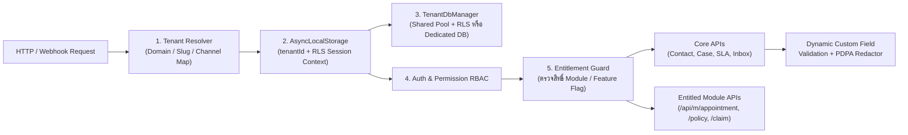
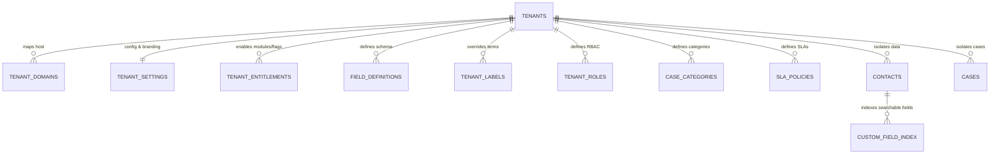

# Phase 1: Target Architecture Design (`cusbox360`)

> **เอกสารออกแบบสถาปัตยกรรมเป้าหมาย (เฟส 1 — Design Only, Zero Code Changes)**
> สถาปัตยกรรม: **Single Core + Industry Templates + Runtime Configuration (Modular Monolith)**
> รองรับธุรกิจเริ่มต้น: **Hospital (`hospital`)** และ **Insurance (`insurance`)** พร้อมรองรับ **B2B Wholesale (`b2b_wholesale` สำหรับระบบเดิม)** และ **E-commerce (`ecommerce` ในอนาคต)** จาก **Docker Image เดียว**

---

## 1. ภาพรวมสถาปัตยกรรมและโครงสร้างไดเรกทอรีเป้าหมาย (Target Folder & Module Structure)

### 1.1 แผนผังการทำงานเชิงสถาปัตยกรรม (Runtime Flow)



### 1.2 โครงสร้างโฟลเดอร์เป้าหมาย (`cusbox360/`)

เราจะจัดระเบียบ Repository ใหม่แบบค่อยเป็นค่อยไป (Strangler Pattern) โดยรักษาไฟล์ซอร์สโค้ดทุกไฟล์ที่สร้างหรือแยกออกมาให้มีขนาด **ไม่เกิน 200 บรรทัด** และห้าม `core/` import โค้ดจาก `modules/` เด็ดขาด:

```text
cusbox360/
├── core/                               # [CORE] ไม่รู้จักธุรกิจเฉพาะ ห้ามมี if (industry === ...)
│   ├── shared/                         # สัญญา TypeScript + Zod ที่ใช้ร่วมทั้ง Backend และ Frontend
│   │   ├── types/                      # tenant.ts, customField.ts, module.ts, template.ts, rbac.ts
│   │   ├── permissions/                # corePermissions.ts (contact:*, case:*, inbox:*, admin:*)
│   │   └── schemas/                    # dynamicZodBuilder.ts, templateValidator.ts
│   ├── server/                         # ระบบหลังบ้านแกนกลาง (Express + PostgreSQL)
│   │   ├── db/                         # tenantDbManager.ts, rlsQuery.ts, migrationRunner.ts, migrations/
│   │   ├── tenancy/                    # tenantContext.ts, tenantResolver.ts, tenantRepository.ts
│   │   ├── entitlements/               # entitlementService.ts, requireEntitlement.ts
│   │   ├── rbac/                       # rolePermissionService.ts, requirePermission.ts
│   │   ├── custom-fields/              # fieldDefRepo.ts, fieldIndexService.ts, fieldRedactor.ts
│   │   ├── labels/                     # labelService.ts (ดึงคำศัพท์ต่อ tenant + fallback)
│   │   ├── registry/                   # serverModuleRegistry.ts, domainEventBus.ts
│   │   ├── template-engine/            # yamlLoader.ts, templateMerger.ts, templateExporter.ts, cli.ts
│   │   └── domains/                    # Core CRM & Contact Center Domains:
│   │       ├── contacts/               # Generic Contact API & Repository (แทน Customer ที่ผูก B2B)
│   │       ├── cases/                  # Case/Ticket + Dynamic Category + SLA Calculator Engine
│   │       ├── omnichannel/            # Conversations, Messages, Channel Router, Bot/AI Copilot
│   │       ├── connectors/             # Encrypted Tenant Connector Vault (AES-256-GCM)
│   │       ├── branding/               # Public White-label API (/api/public/branding)
│   │       └── auth/                   # Session, Scrypt, TOTP 2FA, Audit Service
│   └── client/                         # โครงหน้าบ้านแกนกลาง (React Providers, Dynamic UI, Slot Host)
│       ├── providers/                  # TenantConfigProvider, BrandingProvider, EntitlementProvider, LabelProvider
│       ├── registry/                   # clientModuleRegistry.ts, ExtensionSlot.tsx, EntitledRoute.tsx
│       ├── custom-fields/              # DynamicFieldSection.tsx, DynamicFieldInput.tsx, SensitivityBanner.tsx
│       └── hooks/                      # useLabel.ts, useEntitlement.ts, useCustomFields.ts, useTenantBranding.ts
│
├── modules/                            # [MODULES] โมดูลเฉพาะทาง (ทำงานเฉพาะเมื่อ Tenant มี Entitlement)
│   ├── appointment/                    # (Hospital) ตารางแพทย์, จอง/เลื่อนนัดหมาย, แจ้งเตือนก่อนพบแพทย์
│   │   ├── manifest.ts                 # ประกาศ permissions, routes, menus, slots, migrations, events
│   │   ├── migrations/                 # 001_appointment_tables.up.sql / .down.sql
│   │   ├── server/                     # routes.ts, appointmentService.ts, appointmentRepo.ts
│   │   └── client/                     # AppointmentPage.tsx, ContactAppointmentTab.tsx
│   ├── policy/                         # (Insurance) ทะเบียนกรมธรรม์, ตรวจสอบความคุ้มครอง, แจ้งเตือนต่ออายุ
│   │   ├── manifest.ts
│   │   ├── migrations/                 # 001_policy_tables.up.sql / .down.sql
│   │   ├── server/                     # routes.ts, policyService.ts, policyRepo.ts
│   │   └── client/                     # PolicyPage.tsx, ContactPolicyTab.tsx, PolicyRightCard.tsx
│   ├── claim/                          # (Insurance) รับแจ้งเคลม (FNOL), ตรวจเอกสารสินไหม, สถานะอนุมัติเคลม
│   │   ├── manifest.ts
│   │   ├── migrations/                 # 001_claim_tables.up.sql / .down.sql
│   │   ├── server/                     # routes.ts, claimService.ts, claimRepo.ts
│   │   └── client/                     # ClaimPage.tsx, ContactClaimTab.tsx
│   ├── credit-sales/                   # (B2B — ย้ายออกจาก Core เดิม) วงเงินสินเชื่อ, Aging ลูกหนี้, DSO
│   │   ├── manifest.ts
│   │   ├── migrations/                 # 001_credit_tables.up.sql / .down.sql
│   │   ├── server/                     # routes.ts, creditService.ts, creditRepo.ts
│   │   └── client/                     # CreditSalesPage.tsx, ContactCreditCard.tsx, ContactOrdersTab.tsx
│   └── order-tracking/                 # (E-commerce — โครงรองรับอนาคต) คำสั่งซื้อและสถานะพัสดุ
│
├── connectors/                         # [CONNECTORS] ตัวเชื่อมต่อระบบภายนอก
│   ├── channels/                       # line/, meta-facebook/, voice-3cx/, email/, webchat/
│   ├── his-connector/                  # (Hospital) HIS/EMR HL7 FHIR Adapter + Mock Sandbox
│   └── insurance-core/                 # (Insurance) Core Insurance Policy/Claim Adapter + Mock Sandbox
│
├── templates/                          # [TEMPLATES] ชุดตั้งค่า YAML + Seed Data (ห้ามมีโค้ด .ts/.js)
│   ├── schema/
│   │   └── template.schema.json        # JSON Schema มาตรฐานสำหรับ validate ทุก template
│   ├── hospital/
│   │   ├── template.yaml               # HN, แพ้ยา, สิทธิการรักษา, แผนก/แพทย์, นัดหมาย/ผลตรวจ/การเงิน
│   │   └── seed.yaml                   # ข้อมูลตัวอย่างสำหรับ smoke test / demo tenant
│   ├── insurance/
│   │   ├── template.yaml               # เลขกรมธรรม์, ประเภท, วันหมดอายุ, ตัวแทน, เคลม/ต่ออายุ/ร้องเรียน
│   │   └── seed.yaml
│   ├── b2b_wholesale/
│   │   └── template.yaml               # รองรับพฤติกรรมเดิมของระบบปัจจุบัน 100%
│   └── ecommerce/
│       └── template.yaml               # ตัวอย่างเทมเพลตพิสูจน์การเพิ่มธุรกิจใหม่โดยไม่แตะ Core
│
└── deploy/                             # [DEPLOY] ระบบบรรจุภัณฑ์ Cloud & On-Premises (Image เดียว)
    ├── docker-compose.yml              # รันระบบหลัก + PostgreSQL + ตัวแปรตั้งต้น
    ├── helm/cusbox360/                 # Helm Chart (values.yaml, values-hospital.yaml, values-insurance.yaml)
    └── scripts/bootstrap-onprem.sh     # สคริปต์รัน migrate + pre-load template ตามสัญญาเช่าซื้อ/on-prem
```

### 1.3 กฎเหล็กการแยกขอบเขต (Dependency Boundary Rules)
1. **`core/*` -> ห้าม import จาก `modules/*` หรือ `connectors/*` (ยกเว้นผ่าน interface ของ `ModuleRegistry`)**
2. **`modules/<A>` -> ห้าม import ไฟล์ภายในของ `modules/<B>` โดยตรง** ให้สื่อสารผ่าน `DomainEventBus` ใน `core/server/registry` เท่านั้น
3. **`templates/*` -> มีได้เฉพาะไฟล์ `.yaml` และ `.json`** ห้ามมีโค้ด logic ใด ๆ

---

## 2. การออกแบบฐานข้อมูลใหม่ (Target PostgreSQL Schema)



### 2.1 ตาราง Control-Plane & Tenant Configuration

```sql
-- 1. ตารางผู้เช่า (Tenants) — รองรับทั้ง Shared DB วันนี้ และ Dedicated DB-per-Tenant ในอนาคต
CREATE TABLE tenants (
  id                TEXT PRIMARY KEY,                  -- เช่น 'default', 'tnt_hosp_01'
  slug              TEXT UNIQUE NOT NULL,              -- เช่น 'default', 'rama-hospital', 'viriyah-ins'
  name              TEXT NOT NULL,
  status            TEXT NOT NULL DEFAULT 'active'
                    CHECK (status IN ('active', 'suspended', 'provisioning')),
  template_id       TEXT,                              -- template ตั้งต้น เช่น 'hospital', 'insurance'
  template_version  TEXT,                              -- เช่น '1.0.0'
  isolation_mode    TEXT NOT NULL DEFAULT 'shared_db'
                    CHECK (isolation_mode IN ('shared_db', 'dedicated_db')),
  db_dsn_encrypted  TEXT,                              -- เข้ารหัส AES-256-GCM ใช้เมื่อ isolation_mode = 'dedicated_db'
  created_at        TIMESTAMPTZ NOT NULL DEFAULT NOW(),
  updated_at        TIMESTAMPTZ NOT NULL DEFAULT NOW()
);

-- 2. การผูกโดเมนสำหรับ Runtime White-Label & Subdomain Routing
CREATE TABLE tenant_domains (
  hostname          TEXT PRIMARY KEY,                  -- เช่น 'hospital-a.cb360.online', 'crm.myhospital.co.th'
  tenant_id         TEXT NOT NULL REFERENCES tenants(id) ON DELETE CASCADE,
  is_primary        BOOLEAN NOT NULL DEFAULT FALSE,
  created_at        TIMESTAMPTZ NOT NULL DEFAULT NOW()
);
CREATE INDEX idx_tenant_domains_tenant ON tenant_domains(tenant_id);

-- 3. ตั้งค่าราย Tenant: White-label, เวลาทำการ, IVR/Script, Workflows
CREATE TABLE tenant_settings (
  tenant_id         TEXT PRIMARY KEY REFERENCES tenants(id) ON DELETE CASCADE,
  branding          JSONB NOT NULL DEFAULT '{}'::jsonb, -- { appName, logoUrl, iconUrl, faviconUrl, primaryColor, accentColor }
  business_hours    JSONB NOT NULL DEFAULT '{}'::jsonb, -- { timezone, workdays, start, end, holidays }
  ivr_scripts       JSONB NOT NULL DEFAULT '{}'::jsonb, -- { greetingText, callScriptMarkdown, queues }
  workflows         JSONB NOT NULL DEFAULT '[]'::jsonb, -- กฎอัตโนมัติ [{ id, trigger, conditions, actions, origin, isCustomized }]
  general_config    JSONB NOT NULL DEFAULT '{}'::jsonb, -- { defaultLanguage: 'th', currency: 'THB' }
  customized_paths  TEXT[] NOT NULL DEFAULT '{}',       -- บันทึก key ที่ tenant แก้เอง เพื่อไม่ให้ template เขียนทับ
  updated_at        TIMESTAMPTZ NOT NULL DEFAULT NOW()
);

-- 4. Feature Flags & Module Entitlements ต่อ Tenant
CREATE TABLE tenant_entitlements (
  tenant_id         TEXT NOT NULL REFERENCES tenants(id) ON DELETE CASCADE,
  feature_key       TEXT NOT NULL,                     -- เช่น 'module:appointment', 'module:claim', 'connector:his-fhir', 'flag:ai_copilot'
  enabled           BOOLEAN NOT NULL DEFAULT FALSE,
  limits_json       JSONB NOT NULL DEFAULT '{}'::jsonb,-- เช่น { "maxSeats": 50, "aiQuotaPerMonth": 10000 }
  origin            TEXT NOT NULL DEFAULT 'template'
                    CHECK (origin IN ('template', 'license', 'tenant_admin')),
  is_customized     BOOLEAN NOT NULL DEFAULT FALSE,
  updated_at        TIMESTAMPTZ NOT NULL DEFAULT NOW(),
  PRIMARY KEY (tenant_id, feature_key)
);
```

### 2.2 ตาราง Custom Fields, Indexing, Labels, RBAC, Categories & SLA

```sql
-- 5. นิยามฟิลด์เฉพาะธุรกิจ (Field Definitions) + กฎความปลอดภัยระดับฟิลด์ (Field-level ACL)
CREATE TABLE field_definitions (
  id                TEXT PRIMARY KEY,
  tenant_id         TEXT NOT NULL REFERENCES tenants(id) ON DELETE CASCADE,
  entity_type       TEXT NOT NULL                      -- 'contact' | 'case' | 'appointment' | 'policy' | 'claim'
                    CHECK (entity_type IN ('contact', 'case', 'deal', 'appointment', 'policy', 'claim')),
  field_key         TEXT NOT NULL,                     -- snake_case เช่น 'hn', 'drug_allergies', 'policy_number'
  label             TEXT NOT NULL,                     -- ชื่อแสดงผล เช่น 'รหัสผู้ป่วย (HN)', 'เลขกรมธรรม์'
  field_type        TEXT NOT NULL
                    CHECK (field_type IN (
                      'text', 'textarea', 'number', 'currency', 'date', 'datetime',
                      'boolean', 'select', 'multiselect', 'tags', 'phone', 'email', 'object_list'
                    )),
  options_json      JSONB NOT NULL DEFAULT '[]'::jsonb,-- ตัวเลือกของ select/multiselect [{ value, label, color }]
  validation_json   JSONB NOT NULL DEFAULT '{}'::jsonb,-- { required, regex, regexError, min, max, unique }
  sensitivity       TEXT NOT NULL DEFAULT 'normal'     -- รองรับ PDPA ม.26 โดยไม่ต้อง hard-code ชื่อฟิลด์โรงพยาบาล
                    CHECK (sensitivity IN ('normal', 'pii', 'pdpa_s26')),
  acl_json          JSONB NOT NULL DEFAULT '{}'::jsonb,-- { viewPerm: 'contact.sensitive:view', editPerm: '...', redactMode: 'mask'|'flag_only'|'hide' }
  ui_json           JSONB NOT NULL DEFAULT '{}'::jsonb,-- { group, order, showInList, variableKey: 'hn_number', alertBanner: { whenNonEmpty: true, severity: 'danger', prefix: 'แพ้ยา:' } }
  is_indexed        BOOLEAN NOT NULL DEFAULT FALSE,
  is_active         BOOLEAN NOT NULL DEFAULT TRUE,
  origin            TEXT NOT NULL DEFAULT 'template' CHECK (origin IN ('template', 'tenant')),
  is_customized     BOOLEAN NOT NULL DEFAULT FALSE,
  created_at        TIMESTAMPTZ NOT NULL DEFAULT NOW(),
  updated_at        TIMESTAMPTZ NOT NULL DEFAULT NOW(),
  UNIQUE (tenant_id, entity_type, field_key)
);
CREATE INDEX idx_field_defs_lookup ON field_definitions(tenant_id, entity_type, is_active);

-- 6. ดัชนีค้นหาและบังคับ Unique สำหรับ Custom Fields (ไม่ต้องรัน ALTER TABLE ตอนลูกค้าสร้างฟิลด์เพิ่ม)
CREATE TABLE custom_field_index (
  tenant_id         TEXT NOT NULL REFERENCES tenants(id) ON DELETE CASCADE,
  entity_type       TEXT NOT NULL,
  entity_id         TEXT NOT NULL,
  field_key         TEXT NOT NULL,
  value_text        TEXT,                              -- normalized lowercase string สำหรับค้นหาเร็ว / unique check
  value_num         NUMERIC,                           -- สำหรับกรองช่วงตัวเลข/วงเงิน
  value_date        DATE,                              -- สำหรับกรองวันหมดอายุกรมธรรม์ / วันนัดหมาย
  PRIMARY KEY (tenant_id, entity_type, entity_id, field_key)
);
CREATE INDEX idx_cf_text_search ON custom_field_index(tenant_id, entity_type, field_key, value_text);
CREATE INDEX idx_cf_date_range  ON custom_field_index(tenant_id, entity_type, field_key, value_date);

-- 7. คำศัพท์เฉพาะธุรกิจต่อ Tenant (Labels / Terminology)
CREATE TABLE tenant_labels (
  tenant_id         TEXT NOT NULL REFERENCES tenants(id) ON DELETE CASCADE,
  locale            TEXT NOT NULL DEFAULT 'th',
  label_key         TEXT NOT NULL,                     -- เช่น 'contact.singular' -> 'ผู้ป่วย' | 'ผู้เอาประกัน' | 'ลูกค้า'
  label_value       TEXT NOT NULL,
  origin            TEXT NOT NULL DEFAULT 'template' CHECK (origin IN ('template', 'tenant')),
  is_customized     BOOLEAN NOT NULL DEFAULT FALSE,
  updated_at        TIMESTAMPTZ NOT NULL DEFAULT NOW(),
  PRIMARY KEY (tenant_id, locale, label_key)
);

-- 8. บทบาทและสิทธิ์แบบยืดหยุ่นต่อ Tenant (แทน CHECK (role IN (...)) เดิม)
CREATE TABLE tenant_roles (
  tenant_id         TEXT NOT NULL REFERENCES tenants(id) ON DELETE CASCADE,
  role_key          TEXT NOT NULL,                     -- เช่น 'sysadmin', 'admin', 'agent', 'doctor', 'nurse', 'claim_officer'
  name              TEXT NOT NULL,
  permissions       JSONB NOT NULL DEFAULT '[]'::jsonb,-- ['contact:read', 'contact.pdpa_s26:read', 'appointment:write', ...]
  is_system         BOOLEAN NOT NULL DEFAULT FALSE,
  origin            TEXT NOT NULL DEFAULT 'template' CHECK (origin IN ('template', 'tenant')),
  is_customized     BOOLEAN NOT NULL DEFAULT FALSE,
  PRIMARY KEY (tenant_id, role_key)
);

-- 9. นโยบาย SLA และหมวดหมู่ Ticket/Case ต่อ Tenant
CREATE TABLE sla_policies (
  id                TEXT PRIMARY KEY,
  tenant_id         TEXT NOT NULL REFERENCES tenants(id) ON DELETE CASCADE,
  slug              TEXT NOT NULL,                     -- เช่น 'urgent_medical', 'claim_fasttrack', 'standard'
  name              TEXT NOT NULL,
  first_response_minutes INTEGER NOT NULL,
  resolution_minutes     INTEGER NOT NULL,
  tier_multipliers  JSONB NOT NULL DEFAULT '{}'::jsonb,-- ปรับลดเวลาตามระดับ VIP/Platinum
  escalation_json   JSONB NOT NULL DEFAULT '{}'::jsonb,-- แจ้งเตือนเมื่อเหลือเวลาน้อยกว่า X นาที
  origin            TEXT NOT NULL DEFAULT 'template' CHECK (origin IN ('template', 'tenant')),
  is_customized     BOOLEAN NOT NULL DEFAULT FALSE,
  UNIQUE (tenant_id, slug)
);

CREATE TABLE case_categories (
  id                TEXT PRIMARY KEY,
  tenant_id         TEXT NOT NULL REFERENCES tenants(id) ON DELETE CASCADE,
  slug              TEXT NOT NULL,                     -- เช่น 'appointment', 'lab_inquiry', 'claim', 'policy_renewal'
  name              TEXT NOT NULL,                     -- เช่น 'นัดหมาย', 'สอบถามผลตรวจ', 'เคลม', 'ต่ออายุ'
  sla_policy_slug   TEXT,
  default_queue     TEXT,
  required_fields   JSONB NOT NULL DEFAULT '[]'::jsonb,-- บังคับกรอก custom field เฉพาะหมวดนี้
  sort_order        INTEGER NOT NULL DEFAULT 1,
  is_active         BOOLEAN NOT NULL DEFAULT TRUE,
  origin            TEXT NOT NULL DEFAULT 'template' CHECK (origin IN ('template', 'tenant')),
  is_customized     BOOLEAN NOT NULL DEFAULT FALSE,
  UNIQUE (tenant_id, slug)
);

-- 10. ตารางเก็บค่าเชื่อมต่อภายนอกแบบเข้ารหัสลับต่อ Tenant (แทน src/data/connectors.ts)
CREATE TABLE tenant_connectors (
  tenant_id         TEXT NOT NULL REFERENCES tenants(id) ON DELETE CASCADE,
  connector_id      TEXT NOT NULL,                     -- เช่น 'line', 'his-fhir', 'insurance-core', '3cx'
  connector_type    TEXT NOT NULL,
  status            TEXT NOT NULL DEFAULT 'disconnected',
  public_config     JSONB NOT NULL DEFAULT '{}'::jsonb,-- ข้อมูลไม่ลับ (basicId, webhookUrl, enabledFeatures)
  secrets_encrypted TEXT,                              -- เข้ารหัส AES-256-GCM (accessToken, appSecret, apiKey)
  webhook_route_key TEXT UNIQUE,                       -- เช่น LINE channelId '2011580063' เพื่อแปลง Webhook -> tenant_id
  origin            TEXT NOT NULL DEFAULT 'template' CHECK (origin IN ('template', 'tenant')),
  is_customized     BOOLEAN NOT NULL DEFAULT FALSE,
  updated_at        TIMESTAMPTZ NOT NULL DEFAULT NOW(),
  PRIMARY KEY (tenant_id, connector_id)
);

-- 11. ตารางเคสงานบริการ (Cases / Tickets — ย้ายจาก Mock ขึ้น PostgreSQL จริง)
CREATE TABLE cases (
  id                TEXT NOT NULL,
  tenant_id         TEXT NOT NULL REFERENCES tenants(id) ON DELETE CASCADE,
  contact_id        TEXT NOT NULL,
  title             TEXT NOT NULL,
  category_slug     TEXT NOT NULL,
  channel           TEXT NOT NULL DEFAULT 'LINE',
  status            TEXT NOT NULL DEFAULT 'Open' CHECK (status IN ('Open', 'Pending', 'Waiting', 'Closed')),
  priority          TEXT NOT NULL DEFAULT 'normal' CHECK (priority IN ('low', 'normal', 'high', 'urgent')),
  assignee_id       TEXT,
  queue_name        TEXT,
  sla_due_at        TIMESTAMPTZ,
  first_responded_at TIMESTAMPTZ,
  resolved_at       TIMESTAMPTZ,
  custom_fields     JSONB NOT NULL DEFAULT '{}'::jsonb,
  activity_logs     JSONB NOT NULL DEFAULT '[]'::jsonb,
  created_at        TIMESTAMPTZ NOT NULL DEFAULT NOW(),
  updated_at        TIMESTAMPTZ NOT NULL DEFAULT NOW(),
  PRIMARY KEY (tenant_id, id)
);
CREATE INDEX idx_cases_tenant_status ON cases(tenant_id, status, sla_due_at);
CREATE INDEX idx_cases_custom_fields_gin ON cases USING GIN (custom_fields jsonb_path_ops);

-- 12. ตารางควบคุมเวอร์ชัน Migration ของทั้ง Core และ Modules
CREATE TABLE schema_migrations (
  scope             TEXT NOT NULL,                     -- 'core' หรือ 'module:appointment' ฯลฯ
  version           TEXT NOT NULL,                     -- เช่น '001_tenant_foundation'
  checksum          TEXT NOT NULL,
  applied_at        TIMESTAMPTZ NOT NULL DEFAULT NOW(),
  PRIMARY KEY (scope, version)
);
```

### 2.3 การปรับปรุงตารางเดิมทั้ง 13 ตารางให้รองรับ Multi-Tenant & Custom Fields
- เพิ่มคอลัมน์ `tenant_id TEXT NOT NULL DEFAULT 'default' REFERENCES tenants(id)` ให้กับ `users`, `sessions`, `customers` (ทำหน้าที่เป็นตาราง Contact หลักเพื่อ Backward Compatibility), `conversations`, `messages`, `canned_responses`, `ai_summaries`, `ai_usage_logs`, `audit_logs`, `bot_settings`, `consent_dsr_requests`, `consent_policies`, `menu_configs`
- เพิ่ม `custom_fields JSONB NOT NULL DEFAULT '{}'::jsonb` + `GIN Index (custom_fields jsonb_path_ops)` บนตาราง `customers`
- เพิ่ม `origin TEXT DEFAULT 'template'` และ `is_customized BOOLEAN DEFAULT FALSE` บน `canned_responses` และ `menu_configs`
- เปลี่ยน Unique Index จากระดับ Global เป็นระดับ Tenant:
  - `users`: `UNIQUE (tenant_id, LOWER(username))`
  - `canned_responses`: `UNIQUE (tenant_id, LOWER(shortcut))`
- ถอด `users_role_check` ออกจากตาราง `users` แล้วตรวจกับ `tenant_roles` แทน
- เปิด **Row-Level Security (RLS)** บนทุกตารางที่มี `tenant_id`:
  ```sql
  ALTER TABLE customers ENABLE ROW LEVEL SECURITY;
  CREATE POLICY tenant_isolation_policy ON customers
    USING (tenant_id = COALESCE(NULLIF(current_setting('app.current_tenant_id', true), ''), 'default'));
  ```

---

## 3. Interface ของ Module Registry และ Extension Points

### 3.1 สัญญาของ Backend Module (`core/shared/types/module.ts`)

```typescript
import type { Router } from 'express';

export interface PermissionDef {
  code: string;        // เช่น 'appointment:read', 'claim:approve'
  name: string;
  description?: string;
}

export interface DomainEvent<TPayload = Record<string, unknown>> {
  name: string;        // เช่น 'case.created', 'contact.updated', 'webhook.received'
  tenantId: string;
  actorId?: string;
  occurredAt: string;
  payload: TPayload;
}

export interface DomainEventBus {
  publish<T extends Record<string, unknown>>(event: DomainEvent<T>): Promise<void>;
  subscribe<T extends Record<string, unknown>>(
    eventName: string,
    handler: (event: DomainEvent<T>, ctx: ServerModuleContext) => Promise<void>
  ): void;
}

export interface ServerModuleContext {
  getDb: (tenantId: string) => Promise<{ query: (sql: string, params?: unknown[]) => Promise<{ rows: unknown[] }> }>;
  entitlements: { isEnabled: (tenantId: string, key: string) => Promise<boolean> };
  labels: { t: (tenantId: string, key: string, fallback: string) => Promise<string> };
  audit: { log: (entry: Record<string, unknown>) => Promise<void> };
  events: DomainEventBus;
}

export interface VariableResolverInput {
  tenantId: string;
  contactId?: string;
  caseId?: string;
}

export interface ServerModuleManifest {
  id: string;                            // เช่น 'appointment', 'policy', 'claim', 'credit-sales'
  version: string;
  requiredEntitlement: string;           // เช่น 'module:appointment'
  permissions: PermissionDef[];
  migrationsPath?: string;               // โฟลเดอร์ SQL migrations ของโมดูลนี้
  /** Mount อัตโนมัติที่ /api/m/<id> พร้อม requireAuth + requireTenant + requireEntitlement */
  registerRoutes?: (router: Router, ctx: ServerModuleContext) => void;
  /** ดักฟัง Event จาก Core โดย Core ไม่ต้อง import โมดูล */
  registerEventHandlers?: (bus: DomainEventBus, ctx: ServerModuleContext) => void;
  /** คืนค่าตัวแปรสำหรับแทนค่าใน Canned Response / Bot เช่น {appoint_date}, {policy_no} */
  resolveTemplateVariables?: (input: VariableResolverInput, ctx: ServerModuleContext) => Promise<Record<string, string>>;
}
```

### 3.2 สัญญาของ Frontend Module & Named UI Slots (`core/client/registry/`)

```typescript
import type React from 'react';

export type ExtensionSlotName =
  | 'contact.header.banner'      // แถบแจ้งเตือนด้านบนหน้า Contact 360 (แทน <AllergyAlertBanner /> เดิม)
  | 'contact.profile.metrics'    // การ์ดตัวเลขสรุปฝั่งซ้าย (แทนยอดซื้อ/Order 12 เดือนที่ผูก B2B)
  | 'contact.detail.tabs'        // แท็บย่อยตรงกลาง (เช่น นัดหมายแพทย์, กรมธรรม์, เคลม, Orders)
  | 'contact.right_rail.cards'   // การ์ดสรุปด้านขวา (เช่น สิทธิการรักษา, กรมธรรม์ใกล้หมดอายุ, วงเงินเครดิต)
  | 'inbox.context_card.extra'   // ข้อมูลเสริมของการ์ดผู้ติดต่อในหน้า Omnichannel Inbox
  | 'case.drawer.extra';         // ข้อมูลเสริมในลิ้นชักรายละเอียด Ticket/Case

export interface ContactSlotProps {
  contactId: string;
  contact: Record<string, unknown>;
  customFields: Record<string, unknown>;
}

export interface ClientModuleTab {
  key: string;
  labelKey: string;
  defaultLabel: string;
  requiredPermission?: string;
  component: React.LazyExoticComponent<React.ComponentType<ContactSlotProps>>;
}

export interface ClientModuleMenu {
  id: string;
  path: string;                  // เช่น '/m/appointments', '/m/policies', '/m/claims'
  labelKey: string;
  defaultLabel: string;
  icon: string;
  section: 'CDP' | 'ACTIVITY' | 'ADMINISTRATION';
  order: number;
  requiredPermission?: string;
}

export interface ClientModuleManifest {
  id: string;
  requiredEntitlement: string;   // ถ้าระบบตรวจว่า tenant ไม่มี entitlement นี้ ทั้งเมนู, route และ slot จะไม่ถูกโหลดเลย
  menus: ClientModuleMenu[];
  routes: {
    path: string;
    requiredPermission?: string;
    element: React.LazyExoticComponent<React.ComponentType>;
  }[];
  contactTabs?: ClientModuleTab[];
  slots?: Partial<Record<Exclude<ExtensionSlotName, 'contact.detail.tabs'>, React.ComponentType<ContactSlotProps>>>;
}
```

### 3.3 สัญญาของ Connector (`connectors/`)

```typescript
export interface ConnectorHealthResult {
  ok: boolean;
  latencyMs: number;
  message?: string;
}

export interface ExternalConnectorDefinition<TConfig = Record<string, unknown>, TSecrets = Record<string, string>> {
  id: string;                    // เช่น 'his-fhir', 'insurance-core', 'line'
  name: string;
  category: 'channel' | 'his' | 'insurance_core' | 'erp' | 'telephony';
  requiredEntitlement: string;   // เช่น 'connector:his-fhir'
  testConnection: (config: TConfig, secrets: TSecrets) => Promise<ConnectorHealthResult>;
  handleWebhook?: (payload: unknown, headers: Record<string, string>, ctx: ServerModuleContext) => Promise<unknown>;
}
```

---

## 4. สเปกของ `template.yaml`, JSON Schema และคำสั่ง CLI / API

### 4.1 โครงสร้างตัวอย่าง `templates/hospital/template.yaml` (ย่อแสดงโครงสร้างจริง)

```yaml
apiVersion: cb360.io/v1
kind: IndustryTemplate
metadata:
  id: hospital
  version: 1.0.0
  industry: healthcare
  name: Hospital & Healthcare Contact Center
  thaiTitle: โรงพยาบาลและศูนย์การแพทย์

entitlements:
  modules:
    - appointment
  connectors:
    - his-fhir
  flags:
    - ai_copilot
    - voice_3cx
    - pdpa_consent

brandingDefaults:
  primaryColor: "#059669"
  accentColor: "#10B981"

labels:
  th:
    contact.singular: "ผู้ป่วย"
    contact.plural: "ทะเบียนผู้ป่วย"
    contact.create_button: "ลงทะเบียนผู้ป่วยใหม่"
    contact.code_label: "รหัสผู้ป่วย (HN)"
    case.singular: "เคสผู้ป่วย"
    case.plural: "เคสบริการทางการแพทย์"

roles:
  - key: doctor
    name: "แพทย์ (Doctor)"
    permissions: ["contact:read", "contact:write", "contact.pdpa_s26:read", "contact.pdpa_s26:write", "appointment:read", "appointment:write", "case:read", "case:write"]
  - key: nurse
    name: "พยาบาลวิชาชีพ (Nurse)"
    permissions: ["contact:read", "contact.pdpa_s26:read", "contact.allergy:write", "appointment:read", "appointment:write", "case:read", "case:write"]
  - key: agent
    name: "เจ้าหน้าที่ Contact Center โรงพยาบาล"
    permissions: ["contact:read", "contact:write", "appointment:read", "appointment:write", "case:read", "case:write", "inbox:read", "inbox:write"]

customFields:
  contact:
    - key: hn
      label: "เลขประจำตัวผู้ป่วย (HN)"
      type: text
      isIndexed: true
      validation:
        required: true
        unique: true
        regex: "^[A-Za-z0-9-]{3,20}$"
        regexError: "รูปแบบ HN ต้องเป็นตัวอักษรหรือตัวเลข 3-20 ตัว"
      ui:
        group: "ข้อมูลเวชระเบียน"
        order: 1
        showInList: true
        variableKey: "hn_number"
    - key: drug_allergies
      label: "ประวัติการแพ้ยา"
      type: tags
      sensitivity: pdpa_s26
      acl:
        viewPerm: "contact.pdpa_s26:read"
        editPerm: "contact.allergy:write"
        redactMode: "flag_only"
      ui:
        group: "ข้อมูลความปลอดภัยทางการแพทย์"
        order: 2
        alertBanner:
          whenNonEmpty: true
          severity: danger
          prefix: "แพ้ยา:"
          redactedMessage: "มีประวัติแพ้ยา (กรุณาตรวจสอบกับแพทย์หรือพยาบาล)"
    - key: treatment_right
      label: "สิทธิการรักษาหลัก"
      type: select
      isIndexed: true
      options:
        - { value: "SELF_PAY", label: "ชำระเงินเอง" }
        - { value: "PRIVATE_INS", label: "ประกันสุขภาพเอกชน (OPD/IPD)" }
        - { value: "SSO", label: "ประกันสังคม" }
        - { value: "UCS", label: "สิทธิบัตรทอง (สปสช.)" }
      ui:
        group: "สิทธิการรักษา"
        order: 3
    - key: preferred_department
      label: "แผนก / ศูนย์การแพทย์ประจำ"
      type: text
      ui: { group: "การรักษา", order: 4, variableKey: "department" }
    - key: preferred_doctor
      label: "แพทย์เจ้าของไข้"
      type: text
      ui: { group: "การรักษา", order: 5, variableKey: "doctor_name" }

slaPolicies:
  - slug: medical_urgent
    name: "เร่งด่วนทางการแพทย์ / ร้องเรียน"
    firstResponseMinutes: 15
    resolutionMinutes: 120
  - slug: hospital_standard
    name: "บริการนัดหมายและสอบถามทั่วไป"
    firstResponseMinutes: 30
    resolutionMinutes: 240

caseCategories:
  - { slug: "appointment", name: "นัดหมายแพทย์ / เลื่อนนัด", slaPolicySlug: "hospital_standard", defaultQueue: "Appointment Desk" }
  - { slug: "lab_result", name: "สอบถามผลตรวจสุขภาพ / ผลแล็บ", slaPolicySlug: "hospital_standard", defaultQueue: "Nursing Triage" }
  - { slug: "complaint", name: "ร้องเรียนบริการ", slaPolicySlug: "medical_urgent", defaultQueue: "Patient Relations" }
  - { slug: "billing", name: "การเงิน / ประเมินค่ารักษา / สิทธิประกัน", slaPolicySlug: "hospital_standard", defaultQueue: "Medical Billing" }

workflows:
  - id: wf_hosp_complaint_escalate
    name: "แจ้งเตือนหัวหน้างานทันทีเมื่อเปิดเคสร้องเรียน"
    trigger: "case.created"
    conditions:
      - { field: "category_slug", operator: "eq", value: "complaint" }
    actions:
      - { type: "set_priority", value: "urgent" }
      - { type: "notify_role", role: "supervisor", message: "มีเคสร้องเรียนผู้ป่วยใหม่ #{case_id}" }
```

### 4.2 JSON Schema สำหรับ Validate `template.yaml` (Draft 2020-12)

ไฟล์นี้จะถูกวางไว้ที่ `templates/schema/template.schema.json` และใช้ในคำสั่ง `template validate`:

```json
{
  "$schema": "https://json-schema.org/draft/2020-12/schema",
  "$id": "https://cusbox360.io/schemas/template.v1.json",
  "title": "CusBox360 Industry Template Specification",
  "type": "object",
  "additionalProperties": false,
  "required": ["apiVersion", "kind", "metadata", "entitlements", "labels", "customFields", "slaPolicies", "caseCategories"],
  "properties": {
    "apiVersion": { "const": "cb360.io/v1" },
    "kind": { "const": "IndustryTemplate" },
    "metadata": {
      "type": "object",
      "additionalProperties": false,
      "required": ["id", "version", "industry", "name", "thaiTitle"],
      "properties": {
        "id": { "type": "string", "pattern": "^[a-z0-9_-]{2,40}$" },
        "version": { "type": "string", "pattern": "^\\d+\\.\\d+\\.\\d+$" },
        "industry": { "type": "string", "minLength": 2 },
        "name": { "type": "string", "minLength": 2 },
        "thaiTitle": { "type": "string", "minLength": 2 },
        "description": { "type": "string" }
      }
    },
    "entitlements": {
      "type": "object",
      "additionalProperties": false,
      "required": ["modules"],
      "properties": {
        "modules": { "type": "array", "items": { "type": "string", "pattern": "^[a-z0-9-]+$" }, "uniqueItems": true },
        "connectors": { "type": "array", "items": { "type": "string", "pattern": "^[a-z0-9-]+$" }, "uniqueItems": true },
        "flags": { "type": "array", "items": { "type": "string", "pattern": "^[a-z0-9_]+$" }, "uniqueItems": true }
      }
    },
    "brandingDefaults": {
      "type": "object",
      "additionalProperties": false,
      "properties": {
        "primaryColor": { "type": "string", "pattern": "^#[0-9A-Fa-f]{6}$" },
        "accentColor": { "type": "string", "pattern": "^#[0-9A-Fa-f]{6}$" },
        "logoUrl": { "type": "string" }
      }
    },
    "labels": {
      "type": "object",
      "minProperties": 1,
      "additionalProperties": {
        "type": "object",
        "additionalProperties": { "type": "string", "minLength": 1 }
      }
    },
    "roles": {
      "type": "array",
      "items": {
        "type": "object",
        "additionalProperties": false,
        "required": ["key", "name", "permissions"],
        "properties": {
          "key": { "type": "string", "pattern": "^[a-zA-Z0-9_-]{2,32}$" },
          "name": { "type": "string", "minLength": 1 },
          "permissions": { "type": "array", "items": { "type": "string" }, "minItems": 1 }
        }
      }
    },
    "customFields": {
      "type": "object",
      "additionalProperties": false,
      "properties": {
        "contact": { "$ref": "#/$defs/fieldList" },
        "case": { "$ref": "#/$defs/fieldList" }
      }
    },
    "slaPolicies": {
      "type": "array",
      "minItems": 1,
      "items": {
        "type": "object",
        "additionalProperties": false,
        "required": ["slug", "name", "firstResponseMinutes", "resolutionMinutes"],
        "properties": {
          "slug": { "type": "string", "pattern": "^[a-z0-9_]+$" },
          "name": { "type": "string", "minLength": 1 },
          "firstResponseMinutes": { "type": "integer", "minimum": 1 },
          "resolutionMinutes": { "type": "integer", "minimum": 1 },
          "escalationMinutesBeforeBreach": { "type": "integer", "minimum": 1 }
        }
      }
    },
    "caseCategories": {
      "type": "array",
      "minItems": 1,
      "items": {
        "type": "object",
        "additionalProperties": false,
        "required": ["slug", "name", "slaPolicySlug"],
        "properties": {
          "slug": { "type": "string", "pattern": "^[a-z0-9_]+$" },
          "name": { "type": "string", "minLength": 1 },
          "slaPolicySlug": { "type": "string" },
          "defaultQueue": { "type": "string" },
          "requiredFields": { "type": "array", "items": { "type": "string" } }
        }
      }
    },
    "workflows": {
      "type": "array",
      "items": {
        "type": "object",
        "additionalProperties": false,
        "required": ["id", "name", "trigger", "actions"],
        "properties": {
          "id": { "type": "string", "pattern": "^[a-z0-9_]+$" },
          "name": { "type": "string" },
          "trigger": { "enum": ["case.created", "case.status_changed", "case.sla_warning", "message.received", "contact.created"] },
          "conditions": {
            "type": "array",
            "items": {
              "type": "object",
              "required": ["field", "operator", "value"],
              "properties": {
                "field": { "type": "string" },
                "operator": { "enum": ["eq", "neq", "in", "contains"] },
                "value": {}
              }
            }
          },
          "actions": {
            "type": "array",
            "minItems": 1,
            "items": {
              "type": "object",
              "required": ["type"],
              "properties": {
                "type": { "enum": ["assign_queue", "set_priority", "notify_role", "add_tag", "emit_webhook"] },
                "value": { "type": "string" },
                "role": { "type": "string" },
                "message": { "type": "string" }
              }
            }
          }
        }
      }
    },
    "omnichannelPresets": {
      "type": "object",
      "additionalProperties": false,
      "properties": {
        "ivrGreeting": { "type": "string" },
        "agentCallScript": { "type": "string" },
        "cannedResponses": {
          "type": "array",
          "items": {
            "type": "object",
            "required": ["id", "shortcut", "title", "category", "content"],
            "properties": {
              "id": { "type": "string" },
              "shortcut": { "type": "string" },
              "title": { "type": "string" },
              "category": { "enum": ["greeting", "question", "answer"] },
              "content": { "type": "string" },
              "tags": { "type": "array", "items": { "type": "string" } }
            }
          }
        },
        "botRules": {
          "type": "array",
          "items": {
            "type": "object",
            "required": ["id", "name", "keywords"],
            "properties": {
              "id": { "type": "string" },
              "name": { "type": "string" },
              "keywords": { "type": "array", "items": { "type": "string" }, "minItems": 1 },
              "matchType": { "enum": ["contains", "exact"] },
              "cannedResponseId": { "type": "string" },
              "priority": { "type": "integer", "minimum": 0 }
            }
          }
        },
        "knowledgeItems": {
          "type": "array",
          "items": {
            "type": "object",
            "required": ["id", "title", "category", "content"],
            "properties": {
              "id": { "type": "string" },
              "title": { "type": "string" },
              "category": { "type": "string" },
              "content": { "type": "string" },
              "tags": { "type": "array", "items": { "type": "string" } }
            }
          }
        }
      }
    }
  },
  "$defs": {
    "fieldList": {
      "type": "array",
      "items": {
        "type": "object",
        "additionalProperties": false,
        "required": ["key", "label", "type"],
        "properties": {
          "key": { "type": "string", "pattern": "^[a-z][a-z0-9_]{1,40}$" },
          "label": { "type": "string", "minLength": 1 },
          "type": {
            "enum": ["text", "textarea", "number", "currency", "date", "datetime", "boolean", "select", "multiselect", "tags", "phone", "email", "object_list"]
          },
          "isIndexed": { "type": "boolean" },
          "options": {
            "type": "array",
            "items": {
              "type": "object",
              "required": ["value", "label"],
              "properties": {
                "value": { "type": "string" },
                "label": { "type": "string" }
              }
            }
          },
          "validation": {
            "type": "object",
            "additionalProperties": false,
            "properties": {
              "required": { "type": "boolean" },
              "unique": { "type": "boolean" },
              "regex": { "type": "string" },
              "regexError": { "type": "string" },
              "min": { "type": "number" },
              "max": { "type": "number" }
            }
          },
          "sensitivity": { "enum": ["normal", "pii", "pdpa_s26"] },
          "acl": {
            "type": "object",
            "additionalProperties": false,
            "properties": {
              "viewPerm": { "type": "string" },
              "editPerm": { "type": "string" },
              "redactMode": { "enum": ["mask", "flag_only", "hide"] }
            }
          },
          "ui": {
            "type": "object",
            "additionalProperties": false,
            "properties": {
              "group": { "type": "string" },
              "order": { "type": "integer" },
              "showInList": { "type": "boolean" },
              "variableKey": { "type": "string" },
              "alertBanner": {
                "type": "object",
                "required": ["whenNonEmpty", "severity", "prefix"],
                "properties": {
                  "whenNonEmpty": { "type": "boolean" },
                  "severity": { "enum": ["info", "warning", "danger"] },
                  "prefix": { "type": "string" },
                  "redactedMessage": { "type": "string" }
                }
              }
            }
          }
        }
      }
    }
  }
}
```

### 4.3 คำสั่ง CLI & Admin API และกฎการอัปเดตไม่ทับค่าที่ปรับเอง

| คำสั่ง CLI (`node scripts/cb360-cli.js ...`) | REST API คู่ขนาน (`sysadmin`) | การทำงาน |
|---|---|---|
| `tenant create --slug <slug> --name "<name>" --template <tpl> [--domain <host>] [--seed]` | `POST /api/admin/tenants` | สร้างแถว `tenants`, รัน migration ของโมดูลที่เปิดใช้, apply `template.yaml`, สร้าง admin เริ่มต้นของ tenant |
| `template validate [name-or-path]` | `POST /api/admin/templates/validate` | ตรวจโครงสร้าง YAML กับ JSON Schema + ตรวจความถูกต้องของการอ้างอิง (`slaPolicySlug` มีอยู่จริง, `modules` มีใน Registry จริง) |
| `template import <file.yaml> --tenant <slug> [--dry-run]` | `POST /api/admin/tenants/:slug/template/import` | อัปเกรด/ซิงก์ config จากไฟล์เทมเพลตเข้าสู่ tenant แบบ **Non-destructive Merge** |
| `template export --tenant <slug> --out <file.yaml>` | `GET /api/admin/tenants/:slug/template/export` | ส่งออก config ปัจจุบันของ tenant (ไม่รวมข้อมูลลูกค้าและไม่รวม secret) ออกเป็น `template.yaml` มาตรฐาน |

**กฎเหล็ก Non-Destructive Template Upgrade (3-Way Invariant)**:
1. **เมื่อ Admin ของ Tenant แก้ไขค่าใดผ่าน UI/API**: ระบบจะตั้งค่า `is_customized = TRUE` (หรือเพิ่ม key ลง `tenant_settings.customized_paths`) ทันที
2. **เมื่อสั่ง `template import` อัปเดตเวอร์ชันใหม่เข้า Tenant เดิม**:
   - แถวที่ `is_customized = TRUE` หรือ `origin = 'tenant'` -> **ข้ามทั้งหมด (ห้ามเขียนทับ ห้ามลบ)**
   - แถวที่ `origin = 'template'` และ `is_customized = FALSE` -> **อัปเดตให้ตรงตามเทมเพลตเวอร์ชันใหม่**
   - รายการใหม่ที่เพิ่งเพิ่มเข้ามาในเทมเพลตเวอร์ชันใหม่ -> **Insert เพิ่มเข้าไปโดยตั้ง `origin = 'template', is_customized = FALSE`**

---

## 5. แผน Migration ข้อมูลเดิม & แผน Rollback (Backward-Compatible)

เพื่อให้เซิร์ฟเวอร์ที่รันอยู่ในปัจจุบันทำงานต่อเนื่องได้ 100% โดยไม่เกิด Downtime ใช้แผน **Expand -> Backfill -> Enforce** ดังนี้:

1. **ขั้นที่ 1 — Expand (เพิ่มตารางใหม่และ Default Tenant)**:
   - สร้างตารางใหม่ (`tenants`, `tenant_domains`, `tenant_settings`, `tenant_entitlements`, `field_definitions`, `custom_field_index`, `tenant_labels`, `tenant_roles`, `sla_policies`, `case_categories`, `tenant_connectors`, `cases`, `schema_migrations`)
   - สร้าง Tenant เริ่มต้น `id = 'default', slug = 'default'` พร้อม apply เทมเพลต `b2b_wholesale` ให้ทันทีเพื่อให้พฤติกรรมเดิมอยู่ครบ
2. **ขั้นที่ 2 — Backfill (ผูกข้อมูลเดิมเข้า `'default'` โดยไม่ลบคอลัมน์เก่า)**:
   - เติม `tenant_id TEXT NOT NULL DEFAULT 'default'` และ `custom_fields JSONB NOT NULL DEFAULT '{}'::jsonb` บนตารางเดิมทั้ง 13 ตาราง
   - แปลงข้อมูลใน `customer_industry_profiles` เข้าสู่ `customers.custom_fields` (โดยคงตาราง `customer_industry_profiles` เดิมไว้เป็น fallback จนกว่าจะจบเฟส 3)
   - ย้าย LINE Token จาก `connector_settings` เข้า `tenant_connectors` โดยเข้ารหัส `secrets_encrypted` ด้วย AES-256-GCM และตั้ง `webhook_route_key` ให้รองรับ URL Webhook เดิม `/api/webhooks/line/:channelId`
3. **ขั้นที่ 3 — Enforce (เปลี่ยน Constraint & เปิด RLS)**:
   - เปลี่ยน Unique Index ของ `users` และ `canned_responses` เป็น `(tenant_id, ...)`
   - เปิด PostgreSQL Row-Level Security บนทุกตาราง
4. **แผน Rollback (`migrate:down`)**:
   - ทุกไฟล์ `NNN_<name>.up.sql` จะมีคู่ไฟล์ `NNN_<name>.down.sql` เสมอ
   - ขั้นที่ 1–2 ไม่มีการลบตารางหรือลบคอลัมน์เดิมเลย หากต้อง Rollback อิมเมจกลับเป็นเวอร์ชันก่อนหน้า โค้ดเก่าสามารถคิวรีตารางเดิมได้ทันทีเพราะ `tenant_id` มีค่า `DEFAULT 'default'` รองรับการ `INSERT` จากโค้ดเก่าโดยไม่พัง!

---

## 6. Architecture Decision Records (ADRs)

### ADR-001: โมเดลการแยกข้อมูลระหว่างผู้เช่า (Multi-Tenant Isolation Model)
- **บริบท**: ต้องรองรับ SaaS Multi-tenant ในอิมเมจเดียวและฐานข้อมูลเดียวได้อย่างประหยัดทรัพยากร แต่ต้องพร้อมแยกเป็น **DB-per-Tenant** สำหรับลูกค้ารายใหญ่ (โรงพยาบาล/บริษัทประกัน) หรือการติดตั้ง On-prem ในอนาคต
- **ทางเลือกที่พิจารณา**:
  1. *Schema-per-Tenant* (`tenant_a.customers`, `tenant_b.customers`): ยุ่งยากเมื่อมีหลายร้อย tenant และการรัน migration ช้า
  2. *Shared Schema (`tenant_id`) + PostgreSQL RLS + `TenantDbManager` Abstraction* (**เลือกวิธีนี้**)
- **การตัดสินใจ**: ใช้ Shared Schema ที่มี `tenant_id` ทุกตาราง + บังคับ RLS ที่ระดับ PostgreSQL Session (`SET LOCAL app.current_tenant_id = $1`) ควบคู่กับการเรียก DB ผ่าน `TenantDbManager.getClient(tenantId)` เสมอ เมื่อลูกค้ารายใหญ่ต้องการแยก DB เพียงเปลี่ยน `tenants.isolation_mode = 'dedicated_db'` และใส่ `db_dsn_encrypted` ตัว `TenantDbManager` จะคืน Connection Pool แยกให้ทันทีโดยไม่ต้องแก้โค้ดชั้น Repository หรือ Module เลย

### ADR-002: โครงสร้างการเก็บข้อมูล Custom Fields (`JSONB + Index Table` vs `EAV`)
- **บริบท**: แต่ละธุรกิจมีฟิลด์ต่างกันมาก (HN/แพ้ยา vs เลขกรมธรรม์/วันหมดอายุ) ต้อง validate ได้, ค้นหาเร็ว, และบังคับค่าซ้ำ (`unique`) ราย tenant ได้
- **ทางเลือกที่พิจารณา**:
  1. *Entity-Attribute-Value (EAV)*: ต้อง `JOIN` หลายตารางทุกครั้งที่ดึงรายชื่อผู้ติดต่อ ช้าและเขียนคิวรียาก
  2. *Dynamic `ALTER TABLE ADD COLUMN`*: เสี่ยง table lock บน Production และทำ Shared DB ไม่ได้
  3. *`custom_fields JSONB` บนตารางหลัก + `GIN Index` + ตารางดัชนีช่วย `custom_field_index` เฉพาะฟิลด์ที่ `is_indexed = true`* (**เลือกวิธีนี้**)
- **การตัดสินใจ**: เก็บค่าทั้งหมดใน `custom_fields JSONB` เพื่อให้อ่านข้อมูล Contact/Case ทั้งก้อนได้ใน `SELECT` เดียว ใช้ `GIN (jsonb_path_ops)` สำหรับการกรองทั่วไป และซิงก์เฉพาะฟิลด์ที่ตั้งค่า `is_indexed: true` หรือ `unique: true` ลงตาราง `custom_field_index` ตอนบันทึก (ภายใน Transaction เดียวกัน) เพื่อให้ค้นหาช่วงวันที่ (`valid_until`) หรือบังคับ HN / เลขกรมธรรม์ไม่ซ้ำภายใน Tenant เดียวกันได้ด้วย B-Tree มาตรฐาน

### ADR-003: กลไกการโหลด Modules & Plugins ใน Single Docker Artifact
- **บริบท**: ต้องได้ Docker image เดียว ห้าม build แยกตามลูกค้า แต่ต้องไม่ให้ลูกค้าโรงพยาบาลเข้าถึง API/หน้าจอของประกันภัยได้
- **การตัดสินใจ**: รวมโค้ดของทุก Module เข้าไว้ใน Build เดียว (ฝั่ง Frontend แยก Bundle Chunk อัตโนมัติด้วย `React.lazy()` ทำให้เบราว์เซอร์ไม่ดาวน์โหลด JS ของโมดูลที่ไม่ได้เปิดใช้) แล้วควบคุมการเปิด/ปิดที่ **Runtime 2 ชั้น**:
  1. **Backend API Guard**: `requireEntitlement('module:<id>')` ขวางทุก Request ที่ `/api/m/<id>/*` (คืน `403 MODULE_NOT_ENTITLED`)
  2. **Frontend Route & Slot Guard**: `ClientModuleRegistry` กรองเฉพาะโมดูลที่มีใน `entitlements` ของ Tenant ปัจจุบันก่อนเรนเดอร์ Sidebar, Routes และ Named UI Slots

### ADR-004: การเปลี่ยน Hard-coded Medical Policy เป็น Declarative Field Sensitivity
- **บริบท**: เดิมมี `medicalAccessPolicy.js` และ `if (kind === 'hospital')` เพื่อซ่อนข้อมูลแพ้ยาตาม PDPA ม.26 แต่ธุรกิจประกันชีวิตก็มีข้อมูลสุขภาพ/สินไหมที่อ่อนไหวเช่นกัน
- **การตัดสินใจ**: ย้ายนโยบายการเข้าถึงข้อมูลไปไว้ใน `field_definitions` (`sensitivity: 'pdpa_s26'`, `acl_json`) แล้วสร้าง `FieldRedactorService` ใน Core ที่ตรวจ Permission ของผู้เรียกอัตโนมัติทุกครั้งก่อนส่ง JSON ออกทาง API พร้อมบันทึก Audit Log อัตโนมัติเมื่อเปิดดูฟิลด์ `pdpa_s26` โดยไม่มีชื่อธุรกิจปรากฏในโค้ด Core อีกต่อไป

### ADR-005: Dependency ใหม่ที่จะเพิ่ม (ตามกฎต้องอธิบายเหตุผลก่อนเพิ่ม)
- เราจะเพิ่มเฉพาะแพ็กเกจ **`yaml`** (เช่น `yaml` v2 ซึ่งเป็น pure JS zero-dependency มาตรฐานสำหรับอ่าน/เขียนไฟล์ `template.yaml` และ `seed.yaml`) และตัวตรวจ JSON Schema ขนาดเล็ก (หรือสร้าง Validator จาก `zod` v4 ที่มีอยู่แล้วในโปรเจกต์ซึ่งรองรับ `z.toJSONSchema()` ได้โดยไม่ต้องลงไลบรารีเพิ่มเกินจำเป็น!) ส่วน DB ยังคงใช้ `pg` เดิม 100%

---

## 7. แผนแบ่งงานเป็น PR ย่อยตามลำดับ (Incremental, Non-Breaking PR Plan)

ทุก PR ด้านล่างนี้ออกแบบให้ **Build ผ่าน + Test เดิม 302 ข้อผ่าน + Test ใหม่ผ่าน + Deploy ขึ้น `main` ได้ทันทีโดยไม่ทำระบบที่รันอยู่พัง**:

| ลำดับ PR | เฟส | ชื่องานและขอบเขต (ขนาดไฟล์ใหม่ทุกไฟล์ < 200 บรรทัด) | หลักประกันไม่ทำของเดิมพัง (Backward Compatibility) |
|---|---|---|---|
| **PR-01** | เฟส 2 | **SQL Migration Runner & Multi-Tenant Schema Foundation**: สร้าง `migrationRunner`, ตาราง `tenants`, `tenant_domains`, `tenant_settings`, `tenant_entitlements` + เติม `tenant_id DEFAULT 'default'` และ RLS บนตารางเดิม | Seed `'default'` tenant อัตโนมัติ คิวรีเดิมทั้งหมดทำงานบน `'default'` เหมือนเดิม 100% |
| **PR-02** | เฟส 2 | **Tenant Context, `TenantDbManager` & Domain/Webhook Resolver**: สร้าง `AsyncLocalStorage` middleware, แยก LINE Secret/Token เข้า `tenant_connectors` (AES-256-GCM) และถอด plaintext secret ออกจาก `src/data/connectors.ts` | รองรับโดเมนเดิม (`default`) + รองรับ `/api/webhooks/line/:channelId` เดิมและ `env.LINE_CHANNEL_ACCESS_TOKEN` เดิมเป็น fallback |
| **PR-03** | เฟส 2 | **Permission RBAC & Entitlement Service (BE + FE)**: สร้าง `tenant_roles`, `requireEntitlement`, `requirePermission`, `/api/tenant/bootstrap` (ส่ง branding, labels, entitlements ให้ FE) + CSS Variables สำหรับ White-label | Seed role เดิมครบ (`sysadmin`, `admin`, `supervisor`, `SF_1..3`, `doctor`, `nurse`) ผู้ใช้เดิมล็อกอินและเห็นเมนูเดิมครบ |
| **PR-04** | เฟส 2 | **Dynamic Custom Fields, Labels & Sensitivity Redactor**: สร้าง `field_definitions`, `custom_field_index`, `tenant_labels`, `DynamicFieldSection.tsx`, `SensitivityBanner.tsx` และ Hook `useLabel()` | ข้อมูลเดิมใน `customers` ยังแสดงครบ พร้อมเรนเดอร์ custom fields เพิ่มเติมจาก DB |
| **PR-05** | เฟส 2 | **Core Cases/SLA Backend & Module Registry Skeleton**: ย้าย Tickets/Cases + `case_categories` + `sla_policies` ขึ้น PostgreSQL API จริง และสร้าง `ServerModuleRegistry` + `ClientModuleRegistry` + `<ExtensionSlot />` | หน้า `/cases` ใช้งานได้เหมือนเดิมแต่ข้อมูลไม่หายเมื่อรีเฟรชหน้าเว็บ |
| **PR-06** | เฟส 3 | **Extract B2B Credit Sales & Orders into `modules/credit-sales`**: ย้าย `CreditSalesPage`, การ์ดวงเงินเครดิต, แท็บ `Orders` และเลข `SO-10482` ออกจาก Core เข้า `modules/credit-sales` + เสียบผ่าน UI Slots | เปิด entitlement `module:credit-sales` ให้ `'default'` tenant อัตโนมัติ หน้าจอเดิมจึงยังเห็นครบเหมือนเดิม |
| **PR-07** | เฟส 3 | **Purge Remaining Industry `if/else` from Core & Architecture Test**: ลบ `if (kind === 'hospital')`, `switch (kind)`, `AllergyAlertBanner` ตรงใน Core, `users_role_check` ตายตัว + เพิ่ม Vitest Architecture Guard ห้าม `core/` อ้างชื่อธุรกิจ | โปรไฟล์ผู้ป่วยเดิมถูกแปลงเข้า `custom_fields` + `SensitivityBanner` ทำงานแทนแบบ config-driven |
| **PR-08** | เฟส 4 | **Hospital Modules (`modules/appointment` + `connectors/his-connector`)**: สร้างระบบตารางแพทย์/นัดหมาย + HIS FHIR Connector Adapter (พร้อม Mock Sandbox) | โหลดเฉพาะ tenant ที่เปิด `module:appointment` ไม่กระทบ `'default'` tenant |
| **PR-09** | เฟส 4 | **Insurance Modules (`modules/policy` + `modules/claim` + `connectors/insurance-core`)**: สร้างระบบทะเบียนกรมธรรม์, แจ้งเตือนต่ออายุ, รับแจ้งเคลมสินไหม (FNOL) + Core Insurance Connector | โหลดเฉพาะ tenant ที่เปิด `module:policy` และ `module:claim` |
| **PR-10** | เฟส 4 | **Template Engine, `templates/hospital` & `templates/insurance` + CLI/API**: สร้าง JSON Schema validator, `templates/hospital/template.yaml`, `templates/insurance/template.yaml`, `templates/b2b_wholesale/template.yaml`, `templates/ecommerce/template.yaml` + คำสั่ง `tenant create`, `template validate/import/export` | ทดสอบอัปเดต template ซ้ำโดยไม่ทับค่าที่ `is_customized = true` |
| **PR-11** | เฟส 5 | **Single-Image CI/CD, Multi-Template Smoke Matrix & On-Prem Packaging (`deploy/`)**: สร้าง `.github/workflows/ci.yml`, ชุดทดสอบ Smoke Test สร้าง tenant จากทุก template แล้วรัน flow หลัก, `deploy/docker-compose.yml` และ `deploy/helm/cusbox360` | ใช้ `Dockerfile` เดียวรันผ่านทั้ง SaaS Multi-tenant และ On-prem Pre-loaded Template |
